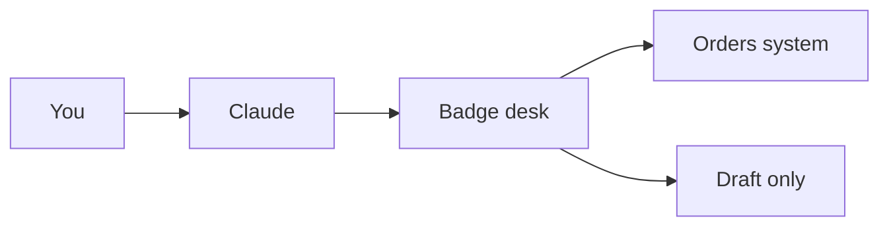
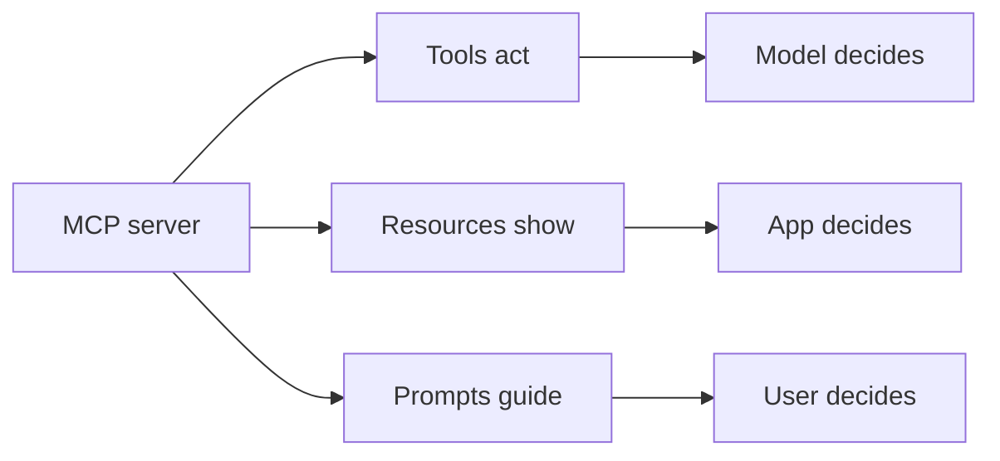
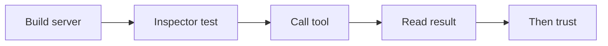

<!--
Worked example: the real output of acceptance test 4 (`/plan-live-session`, no arguments, second
run in a row), produced on 2026-11-18 by a fresh agent following SKILL.md, rendered by
scripts/render_blueprint.js from a blueprint.json that passes validate_blueprint.js.

It is here to show depth and shape, not as a plan to run. Two of its assumptions describe rules
that were tightened after this run: weeks never searched for demand now score a neutral 2 (not 0),
and the channel median now skips uploads under 14 days old (which lowers the 3.4x ratio quoted
here to about 1.6x). Facts and news were checked on 2026-11-18 and will go stale.
-->

# Give Your AI a Badge, Not Keys

> You know which systems your company runs on; tonight your AI reads one, safely.

## 1. Header

| | |
|---|---|
| **Promise** | Build a first MCP server that lets Claude read a sample orders system and nothing else, test it in the MCP Inspector, and turn any write into a draft a person approves. |
| **Air date** | 2026-12-03 |
| **Audience** | students |
| **Length** | 60 minutes |
| **Curriculum** | Week 5: MCP Foundations + First MCP Server |
| **Beat** | Your AI gets hands — it can finally reach the systems your business runs on. |
| **Academy course** | [Introduction to Model Context Protocol](https://anthropic.skilljar.com/introduction-to-model-context-protocol) (confirmed) |
| **Deliverable** | First MCP server: an mcp-server repo with tools/resources/prompts + run instructions; proof is an inspector demo of the server. |
| **Story device** | The trust ladder, Weeks 5–6 rung: "It reaches real systems, read-mostly" |
| **Lens** | build-story |
| **Callback** | Last session, "Make the Check Run Itself" (Episode 1, Week 2), a check that lived in one colleague's head became a skill. Tonight the AI that runs that check gets hands: it reads a real system, and only reads. |
| **Series** | Weekly Live · Episode 2 |
| **Scores** | Idea 73/100 · Room 45/50 · Yield 43/50 |

**Assumptions made (no question was asked):**

- Air date 2026-12-03 is the default next open slot: 2026-11-19 is already taken by Episode 1 and 2026-11-26 was skipped as Thanksgiving, a US federal holiday.
- Thursday is an assumed weekly slot, not confirmed by Ali (history.json schedule.note).
- No air time is set in history.json; every time reads "time to be confirmed (Central)".
- students_on is unknown, so every week scored closeness 3 of 5.
- Series defaulted to "Weekly Live · Episode 2" (episode number from history.js episode); it scores the Idea series line as a named episode.
- Callback is to Episode 1, "Make the Check Run Itself" (Week 2, 2026-11-19), read from history. That session had not aired when this was planned (today is 2026-11-18); re-check that it actually ran before using the callback.
- Two weeks pass between Episode 1 and this session because of the Thanksgiving skip; the callback says "last session", never "last week".
- No story can be under 14 days old on the air date, because planning happened 15 days before it. Topic news fit tops out at 4 and the Idea news line at 3. Re-search on the air date.
- Demand was gathered only for the top three weeks after the first news pass (5, 3, 7), as SKILL.md Stage 1.4 says. Other weeks scored demand 0 by default, which is absence of a search, not absence of demand.
- Channel medians were computed from YouTube's abbreviated counts ("39K") on each channel's /videos page. Most of those ten uploads were under two weeks old, which depresses the median and flatters older videos' ratios; the Idea demand line was held at 4 for that reason.
- Next week's topic (Week 6, the integration on call) is assumed as the open loop; it is not yet planned.
- No proof= was given, so the Idea proof line is capped at 2 and the session's proof is the live build itself.
- Ranking ties broken by the script; the Stage 5 tie between build-story and mistake-teardown (both 68) went to the first in lens order.

### Why this topic (data pick)

| # | Wk | Theme | Close /30 | Uncovered /20 | Demand /20 | Build /15 | News /15 | Total | Evidence |
|---|---|---|---|---|---|---|---|---|---|
| 1 | 5 | MCP Foundations + First MCP Server | 3 → 18 | 5 → 20 | 5 → 20 | 5 → 15 | 4 → 12 | **85** | Kaseya first-party MCP servers (2026-11-17, 16d) and Claude for Manufacturing connectors (2026-11-12, 21d); Tech With Tim 'MCP Servers Explained & Built' 134,322 views vs ~39K channel median (3.4x); Mikey No Code MCP video 23,006 vs ~28.5K (below) |
| 2 | 3 | Claude API + Workflow Assistant | 3 → 18 | 5 → 20 | 3 → 12 | 4 → 12 | 2 → 6 | **68** | Self-hosted Managed Agents (claude.com, 2026-11-12, 21d) touches unattended agents in passing; workflow-automation videos beat their channel medians: Austin Marchese 57,237 vs ~50K median (1.1x), AI Master 18,007 vs ~8.7K (2.1x) |
| 3 | 7 | Subagents + Multi-Agent Team | 3 → 18 | 5 → 20 | 1 → 4 | 4 → 12 | 4 → 12 | **66** | Anthropic 'When to fold subagents into your main agent loop' (2026-10-22, 42d) is the main subject; Fable 5.2 launch (2026-11-09) mentions 1,000+ subagents; Rob Shocks 'Anthropic Says Delete Your Subagents' 49,197 vs ~64.5K median and AICodeKing 10,321 vs ~13K: none outperformed |
| 4 | 10 | Governance + Governance Engine | 3 → 18 | 5 → 20 | 0 → 0 | 4 → 12 | 2 → 6 | **56** | Claude for Manufacturing (2026-11-12): every skill ends with a human review; self-hosted Managed Agents: allowed-hosts list (2026-11-12); both passing mentions; demand not searched |
| 5 | 6 | Advanced MCP + System Integration | 3 → 18 | 5 → 20 | 0 → 0 | 3 → 9 | 2 → 6 | **53** | Self-hosted Managed Agents (2026-11-12, 21d): a proxy adds credentials to MCP tool calls, a passing mention; demand not searched |
| 6 | 1 | Claude Code Foundations + Workspace | 3 → 18 | 5 → 20 | 0 → 0 | 5 → 15 | 0 → 0 | **53** | no story this fortnight on CLAUDE.md or project foundations; demand not searched (outside top three) |

Each cell is the 0–5 factor → its weighted points.

Picked week 5: Top-ranked row (85/100), 17 points clear of week 3. It is the only week with demand at 5 (an MCP build video ran 3.4x its channel median) and its news is on its main subject (vendors shipping MCP servers 16-21 days before air). Week 2 would have ranked third on its own news (65) but Episode 1 covered it, so coverage scored 0 and it fell to tenth.

### Angles considered

| Lens | Title | Idea | Opening line |
|---|---|---|---|
| build-story ✅ | Give Your AI a Badge, Not Keys | 73 | You know which systems your company runs on; tonight your AI reads one, safely. |
| news-consequence | Your Vendors Just Shipped MCP | 64 | Your software vendors are shipping MCP servers; you need to know who holds the keys. |
| mistake-teardown | Don't Give Your AI the Keys | 68 | The worst first MCP server you can build gives your AI write access. |
| student-journey | Your AI Gets Hands Today | 62 | You approved every action in week one; today you let it read your systems. |
| contrarian-take | Your Model Isn't the Problem | 63 | You don't need a smarter model; you need one that can reach your data. |

### Tightening log

| Round | Angle | Title | Score | What changed |
|---|---|---|---|---|
| 0 | build-story | Give Your AI a Badge, Not Keys | 68 | Starting score. Tied with mistake-teardown at 68; took the first in lens order. Ceiling for this angle with this run's evidence is 81 (demand held at 4, proof capped at 2, news capped at 3 by story age). |
| 1 | build-story | Give Your AI a Badge, Not Keys | 73 | Rewrote the two weakest movable lines. Viewer (lost 6): opening line and angle now speak to the professional who knows the company's systems and is moving toward forward deployed work, 3 to 4. Tension (lost 4): angle now names the stake, someone must decide what the AI may touch and a wrong write hits a live system, 3 to 4. Passes 70; stopped. |

### News and demand behind it

- **Kaseya Expands its Agentic IT Management Platform with First-Party MCP Servers, Pre-Built Skills and a Unified Cyber Resilience Portal**, Kaseya, 2026-11-17 (16 days old): https://www.kaseya.com/press-release/kaseya-expands-its-agentic-it-management-platform-with-first-party-mcp-servers-pre-built-skills-and-a-unified-cyber-resilience-portal/
- **Introducing Claude for Manufacturing**, Anthropic (claude.com), 2026-11-12 (21 days old): https://claude.com/blog/claude-for-manufacturing
- **Operate Claude Managed Agents inside your security perimeter**, Anthropic (claude.com), 2026-11-12 (21 days old): https://claude.com/resources/articles/self-hosted-claude-managed-agents
- **The rise of specialized jobs in the AI era**, Pave via Boston 25 News, 2026-11-17 (16 days old): https://www.boston25news.com/news/rise-specialized/22RBK7S7R4YLBPNHYF2Y5UYRCY/
- **AI startup hiring snapshot, 16 November 2026: 6,481 open roles, half at four companies**, DEV Community (Cleanrows), 2026-11-16 (17 days old): https://dev.to/cleanrows/ai-startup-hiring-snapshot-16-november-2026-6481-open-roles-half-at-four-companies-4a7e
- **AWS, Anthropic race to deploy army of specialized engineers key to proving AI spending will pay off**, CNBC, 2026-10-15 (49 days old): https://www.cnbc.com/2026/10/15/aws-anthropic-racing-to-deploy-army-of-specialized-ai-engineers.html
- ▶ MCP Servers Explained & Built: Tech With Tim, 134322 views vs channel median 39000: https://www.youtube.com/watch?v=He8tUwLzLnU
- ▶ How Complete Beginners Master Claude Code MCP in 19 minutes: Mikey No Code, 23006 views vs channel median 28500: https://www.youtube.com/watch?v=dhsyihMpqZQ
- ▶ 6 EASY Steps to Automate 99% of Your Work With Claude: Austin Marchese, 57237 views vs channel median 50000: https://www.youtube.com/watch?v=ktY1b2-OKRA
- ▶ How to Use Claude Cowork 2.0 – Full Workflow Automation Guide 2026: AI Master, 18007 views vs channel median 8650: https://www.youtube.com/watch?v=zo1izxXPbQ4
- ▶ Anthropic Says Delete Your Subagents: Rob Shocks - Switch Dimension, 49197 views vs channel median 64500: https://www.youtube.com/watch?v=KwmrSON2n-g
- ▶ Claude Code is getting rid of SUB-AGENTS?: AICodeKing, 10321 views vs channel median 13000: https://www.youtube.com/watch?v=fdtkh30oFA8

## 2. Run-of-show

| Start | Min | Mode | Segment |
|---|---|---|---|
| 0:00 | 5 | cold-open | The finished answer: a badge, not the keys |
| 0:05 | 8 | teach | A badge, not the keys: what an MCP server is |
| 0:13 | 10 | live-build | Build 1: a server that can only read |
| 0:23 | 9 | teardown | The keys mistake: a write tool with no one approving |
| 0:32 | 10 | live-build | Build 2: Claude reads the orders and answers a buyer's question |
| 0:42 | 9 | hot-seat | Hot seat: design the badge desk for your system |
| 0:51 | 9 | recap | Recap: read before write, then the 2 AM question |

### 0:00 · The finished answer: a badge, not the keys (5 min, cold-open)

- Open on the result: Claude answers which sample orders a two-week steel delay hits, straight from the system, and it cannot change one of them.
- Callback by name: last session, "Make the Check Run Itself", the check stopped living in one head. Tonight the AI reaches a system.
- Name the spine once: we give the AI a badge, not the keys. It reads before it ever writes.

**On screen:** The finished badge-desk server already connected in Claude Code, answering the late-shipment question from the sample orders file (recorded run in tab 2 as backup).
**Chat prompt:** Drop one word in chat: which system at your work would you most want your AI to read?
**Full-screen visual:** Full screen: Claude Code's answer listing affected sample orders, with a SAMPLE DATA banner across the top.
**Sound bites:** sb-6

### 0:05 · A badge, not the keys: what an MCP server is (8 min, teach)

- An MCP server is a badge desk: it decides which doors the AI can open. The model never gets the keys, only what the server exposes.
- Three parts: tools act, resources show, prompts guide. Tools are model-controlled and can write, so they are the ones you gate.
- Why now: Kaseya's first-party MCP servers (Nov 17) and Claude for Manufacturing's connectors to Infor, NetSuite, Fusion and Microsoft 365 (Nov 12). Your vendors are not waiting.

**On screen:** No build yet; the badge-desk diagram and the two vendor announcements side by side.
**Chat prompt:** Poll: your vendor ships an MCP server tomorrow. What do you switch on first?
**Full-screen visual:** The badge-desk flowchart full screen: You, Claude, badge desk, orders system, draft only.
**Sound bites:** sb-1, sb-8, sb-9

### 0:13 · Build 1: a server that can only read (10 min, live-build)

- From an empty folder, Claude Code generates a fictional orders file and a server with exactly one read tool. Sample data only, never a real system.
- The tool's description is the whole interface: Claude picks tools by what the description says, so we write it in plain English.
- Test before trust: the MCP Inspector calls the tool once, and we read the result before anyone wears the badge.

**On screen:** Claude Code runs instruction 1: creates the badge-desk folder, the SAMPLE DATA orders file and the find_orders_by_material tool, then opens it in the MCP Inspector and calls it for steel.
**Chat prompt:** Type READY when your own folder exists, or STUCK and a mentor will jump in.
**Full-screen visual:** The MCP Inspector showing one tool and its steel-orders result, full screen.
**Sound bites:** sb-10, sb-12

### 0:23 · The keys mistake: a write tool with no one approving (9 min, teardown)

- On a throwaway copy, add the mistake on purpose: a tool that rewrites due dates. One vague sentence moves every steel order and nobody approved it.
- Anthropic's own manufacturing example: the buyer, not the AI, releases the purchase order, and Claude's access follows her permissions.
- Rebuild it as draft_reschedule: the AI writes a proposal, a person approves it. The orders file never changes.

**On screen:** Claude Code runs instruction 2 on a throwaway copy: adds reschedule_order, shows the changed sample rows, deletes the copy, then adds draft_reschedule to the real server and proves the orders file is unchanged.
**Chat prompt:** Poll: which of these would you let an AI run without a person approving it?
**Full-screen visual:** Before and after: the sample orders file rewritten by the bad tool next to the drafts file from the good one.
**Sound bites:** sb-3, sb-7, sb-11

### 0:32 · Build 2: Claude reads the orders and answers a buyer's question (10 min, live-build)

- Register the server for this project only: the badge works in one building, not every project on the laptop.
- Add a read-only resource (the supplier list) and a prompt called late_shipment_impact, so the question is asked the same way every time.
- Ask the buyer's question: a steel delay of 14 days, which orders are affected, which supplier could cover them. The answer comes from the system.

**On screen:** Claude Code runs instruction 3: registers the server for this project, adds the supplier resource and the late_shipment_impact prompt, reloads, answers the question and lists every tool to prove none can write.
**Chat prompt:** Diagnostic: Claude Code cannot see your new server. What do you check first?
**Full-screen visual:** Claude Code's answer naming the affected sample orders and a backup supplier, with the tool list beside it: one read tool, one draft tool.
**Sound bites:** sb-4

### 0:42 · Hot seat: design the badge desk for your system (9 min, hot-seat)

- Two volunteers name a system from their work; Ali sketches its badge desk live: one read tool, one resource, what would ever need a draft, who approves.
- The job behind this: Pave's index ranks Forward Deployed Engineer the second-hottest job in tech, and the work is getting AI working inside a company's systems.
- Keep it honest: no real system goes on screen, only the shape of the desk. The build stays on sample data.

**On screen:** A blank badge-desk template filled in live for each volunteer's system: tools, resources, prompts, drafts, approver.
**Chat prompt:** Self-check in chat: name one system at your company and the first read-only question you would let AI answer about it.
**Full-screen visual:** The filled badge-desk template for the volunteer's system, full screen.
**Sound bites:** sb-2

### 0:51 · Recap: read before write, then the 2 AM question (9 min, recap)

- Spine one last time: a badge, not the keys. Read before write, draft before send, human before live.
- Build-along: your own badge desk on sample data, with one read tool, one resource, one prompt and one draft tool, proven in the Inspector.
- Next session: the integration goes on call. It is 2 AM and the system behind your server is down. Does it fail loudly or quietly?

**On screen:** The trust ladder with this week's rung lit: it reaches real systems, read-mostly.
**Chat prompt:** Self-check: from 'I watched' to 'I could build this tonight', where are you?
**Full-screen visual:** The trust ladder full screen with Week 5's rung highlighted.
**Sound bites:** sb-5

## 3. Sound bites

| Id | Kind | Score | Segment | Line |
|---|---|---|---|---|
| sb-1 | news-take | 75 | badge-desk | “Your vendors are not waiting for you: Kaseya and Infor already let Claude reach their systems.” |
| sb-2 | number | 77 | hot-seat | “Anthropic is putting $100 million into training 10,000 forward deployed engineers; the skill is not magic.” |
| sb-3 | mistake | 91 | keys-mistake | “The worst first MCP server gives your AI write access, not read access, on day one.” |
| sb-4 | framework | 75 | build-connect | “Read before write, draft before send, human before live: never let your AI skip a step.” |
| sb-5 | prediction | 75 | recap | “Soon, most software your company buys will ship an MCP server; deciding what it touches will not be optional.” |
| sb-6 | contrarian | 75 | cold-open | “You do not need a smarter model; you need a model that can reach your data.” |
| sb-7 | story-30s | 77 | keys-mistake | “A steel shipment slips two weeks, and the buyer, not the AI, decides what happens next.” |
| sb-8 | framework | 75 | badge-desk | “Your MCP server is a badge desk: it decides which doors your AI can open, not the model.” |
| sb-9 | number | 79 | badge-desk | “Forward deployed engineer scored 97.0 on Pave's Hot Jobs Index, and the job starts with your first MCP server.” |
| sb-10 | mistake | 81 | build-read | “Never point a first server at live data; a sample folder fails safely and costs you nothing.” |
| sb-11 | news-take | 81 | keys-mistake | “Claude for Manufacturing ends every skill with a human review; your first server should not skip it either.” |
| sb-12 | other | 89 | build-read | “We built a server that could read every order, and it still could not change one.” |

**sb-7, the 30-second story:** Anthropic tells this one about its own manufacturing plugin. A steel shipment slips two weeks. The buyer asks Claude which customer orders are affected and how much steel the other sites have. Claude can answer from the systems the plant already runs. It can even release a purchase order to another supplier and reschedule production. But only after the buyer approves, and only with her own permissions. The AI does the legwork. The buyer still decides.

## 4. Slides

### 1. Give Your AI a Badge, Not Keys — title (cold-open)

- Weekly Live · Episode 2
- Your AI reads a real system tonight, and only reads

**Visual:** Dark slide, a single ID badge icon in the center with the title beneath it; no logos.

**Speaker note:** Do not read the slide. Say the callback first: last session the check stopped living in one head. Then switch to the finished answer on the next slide within 30 seconds.
**publicValue:** Episode title card for the edited video

### 2. The finished answer — demo (cold-open)

- A two-week steel delay: which orders does it hit?
- Answered from the system, not from memory
- And it cannot change a single order

**Visual:** Screen capture of Claude Code answering the late-shipment question from the SAMPLE DATA orders file, affected orders highlighted.

**Speaker note:** Show, do not explain. Let the answer sit for five seconds, then say: by minute 42 you will have built this yourself. If the live run stalls, switch to the recorded run in tab 2.
**publicValue:** Cold open: the finished result in the first minute

### 3. A badge, not the keys — teach (badge-desk)

- The server decides which doors the AI can open
- The model never holds the keys
- Read first; anything that writes becomes a draft

**Visual:** The badge-desk flowchart, full screen, with the Draft only box in amber.



**Speaker note:** Walk the boxes left to right. Land on the badge desk: this is the thing you build tonight. Then point at Draft only: anything that would change the system stops here for a person.
**publicValue:** The core metaphor clip: what an MCP server is, for a non-engineer

### 4. Your vendors are not waiting — data (badge-desk)

- Nov 17: Kaseya MCP servers for Autotask, Datto RMM and IT Glue (early access)
- Nov 12: Claude for Manufacturing connects Fusion, Infor, Microsoft 365, NetSuite
- Every one of those skills ends with a person's review

**Visual:** Two announcement headlines side by side with their dates, each source URL in small type beneath.

**Speaker note:** Open both source pages live rather than trusting the slide; they were checked on November 18 and must be re-checked on the air date. The point is not the vendors, it is that someone at your company will be asked what to switch on.
**publicValue:** News clip: AI is being wired into business systems this month

### 5. Three parts of every server — teach (badge-desk)

- Tools act, and the model decides when
- Resources show read-only context
- Prompts are playbooks a person picks

**Visual:** The three-part flowchart full screen, the Tools branch outlined in amber because it is the one that can write.



**Speaker note:** Say who controls each part, because that is the governance lesson in one picture: the model controls tools, the application controls resources, the user controls prompts. Tools are where a write can happen, so tools are what we gate.
**publicValue:** Explainer clip: tools, resources and prompts in under a minute

### 6. Build 1: a server that can only read — demo (build-read)

- Empty folder, fictional orders file
- One tool: find orders by material
- Tested in the MCP Inspector before anyone uses it

**Visual:** Claude Code on the left running the instruction, the MCP Inspector on the right showing the single tool.

**Instruction to Claude Code:**

```text
Run these steps yourself — do not print commands for me to copy and paste.
1. Create a new empty folder called badge-desk with a sample-data folder inside it.
   # WHY: a sandbox. Nothing in this folder touches a real company system.
2. Generate a fictional orders file for a made-up metal fabricator: order id, customer, material, quantity, due date, supplier. Put SAMPLE DATA as the first line.
   # WHY: realistic enough to ask real questions, fake enough to show on a livestream.
3. Build an MCP server in this folder with exactly one tool, find_orders_by_material, that reads the orders file and returns matching rows. No tool may write, delete or send anything.
   # WHY: read before write. The first rung of reach is looking, not touching.
4. Give the tool and each input a plain-English description of when to use it.
   # WHY: Claude picks a tool by its description. A vague description becomes a wrong answer later.
5. Open the server in the MCP Inspector, call the tool once with material set to steel, and show me the result.
   # WHY: test the badge before anyone wears it.
Stop when the Inspector shows only the steel orders and nothing else.
```

**Speaker note:** Narrate the decisions, not the characters: why one tool, why sample data, why the description matters. If the Inspector does not open, ask Claude Code to check the Node version it needs and fix it itself.
**publicValue:** Main build footage: a first MCP server from an empty folder

### 7. Test it before you trust it — teach (build-read)

- The Inspector is the reference test tool for MCP servers
- Call the tool yourself before Claude does
- Read the raw result: is anything there you did not expect?

**Visual:** The test-before-trust flowchart full screen.



**Speaker note:** This is checkpoint CP0 and CP1 of the Week 5 build map: the server runs, it is visible in the Inspector, and one tool works. Ask the room to type READY or STUCK before moving on.
**publicValue:** Teaching clip: how to test an AI connection before you rely on it

### 8. The steel shipment — story (keys-mistake)

- A steel shipment slips two weeks
- Claude can find the affected orders and a backup supplier
- The buyer approves before anything is released

**Visual:** A plain card with no photo: a calendar page with two weeks crossed out, and the line 'The buyer decides.'

**Speaker note:** Tell it as Anthropic's own example from the Claude for Manufacturing announcement, not as a real customer. Slow down on 'only after the buyer approves'. Then go straight into the teardown.
**publicValue:** Story Short: the buyer, not the AI, decides

### 9. Turn the key into a draft — demo (keys-mistake)

- Throwaway copy: a tool that rewrites due dates
- Watch one vague request move every steel order
- Real server: draft_reschedule, a person approves

**Visual:** Split screen: the sample orders file after the bad tool ran, beside the drafts file the good tool wrote.

**Instruction to Claude Code:**

```text
Run these steps yourself — do not print commands for me to copy and paste.
1. Make a throwaway copy of the badge-desk server. In the copy only, add a tool called reschedule_order that changes an order's due date in the sample file.
   # WHY: this is the mistake we are studying. It lives in a copy and touches sample data only.
2. Using the copy, move every steel order back two weeks, then show me exactly which rows changed.
   # WHY: one vague sentence just rewrote a pile of rows, and nobody approved it.
3. Delete the throwaway copy. In the real server, add draft_reschedule instead: it writes a proposed change to a drafts file and changes nothing else.
   # WHY: the AI drafts, a person approves. That is the human review step the vendors ship too.
4. Show me the drafts file, and prove the real orders file is unchanged.
Stop when the orders file is unchanged and the drafts file lists each proposed move.
```

**Speaker note:** This is the deliberate failure. Do not hide the changed rows; that moment is the lesson. Confirm out loud that the copy is deleted before moving on.
**publicValue:** High-retention teardown: the write-access mistake and its fix

### 10. Read, draft or write? — poll (keys-mistake)

- Look up an order
- Draft a reschedule
- Reschedule an order

**Visual:** Three large option tiles; the live vote bars fill as answers arrive.

**Speaker note:** Expect the room to split between draft and reschedule. Reveal: look-ups and drafts can run without a person; anything that changes the system waits for one.
**publicValue:** Interaction clip: where should the human gate go?

### 11. Build 2: Claude answers the buyer — demo (build-connect)

- Register the server for this project only
- Add the supplier list and a late-shipment playbook
- Ask the buyer's question; prove nothing can write

**Visual:** Claude Code's answer naming affected sample orders and a backup supplier, the server's tool list beside it.

**Instruction to Claude Code:**

```text
Run these steps yourself — do not print commands for me to copy and paste.
1. Register the badge-desk server with this Claude Code project only, not for every project on this machine.
   # WHY: the badge works in one building. Other projects never see it.
2. Add a resource that exposes the supplier list from the sample data as read-only context.
   # WHY: resources are for looking things up, not for acting.
3. Add a prompt called late_shipment_impact that takes a material and a delay in days.
   # WHY: a prompt is the playbook a person picks, so the question is asked the same way every time.
4. Reload so the server is picked up, then run late_shipment_impact for steel with a 14-day delay: which customer orders are affected, and which supplier could cover them?
   # WHY: this is the question a buyer actually asks. The answer comes from the system, not from memory.
5. List every tool the server exposes and confirm none of them can change the orders file.
Stop when the answer names affected sample orders and the tool list shows only the read tool and the draft tool.
```

**Speaker note:** This is CP2 and CP3 of the Week 5 build map: a resource and a prompt, then a real host calls it. If Claude Code cannot see the server, have it list its MCP servers and reload itself; do not debug by hand.
**publicValue:** Payoff footage: the AI answers a business question from a system

### 12. Your badge desk — quote (hot-seat)

- Which system?
- Which read-only question first?
- What would ever need a draft, and who approves it?

**Visual:** A blank badge-desk template with four empty boxes: tools, resources, prompts, approver.

**Speaker note:** Take two volunteers. Fill the template for their system without putting any real data or screens on air. If nobody volunteers, use the claims-intake example: read the claim, draft the note, a person files it.
**publicValue:** Hot-seat clip: designing access for a viewer's real system

### 13. Read before write — close (recap)

- A badge, not the keys
- Build-along: your own badge desk on sample data
- Next: it's 2 AM and the system is down

**Visual:** The trust ladder with the Week 5 rung lit, and the next session's question beneath it.

**Speaker note:** Restate the spine in one sentence, read the build-along proof line off the slide, then ask the 2 AM question and stop talking. Leave it open.
**publicValue:** Close and next-live CTA

## 5. Facts and data points

29 facts · 10 still marked **verify**.

| Id | Claim | Status | Source | Published | Claims registry | Used in |
|---|---|---|---|---|---|---|
| f1 | Kaseya released first-party MCP servers for Autotask, Datto RMM and IT Glue, available in early access through GitHub, on 2026-11-17. | sourced | [Kaseya press release](https://www.kaseya.com/press-release/kaseya-expands-its-agentic-it-management-platform-with-first-party-mcp-servers-pre-built-skills-and-a-unified-cyber-resilience-portal/) | 2026-11-17 | n/a Third-party fact, not a claim about Colaberry. | slides.s4, soundBites.sb-1, runOfShow.badge-desk, contentYield.linkedinPost, angles |
| f2 | Kaseya ships 17 pre-built skills alongside the MCP servers. | sourced | [Kaseya press release](https://www.kaseya.com/press-release/kaseya-expands-its-agentic-it-management-platform-with-first-party-mcp-servers-pre-built-skills-and-a-unified-cyber-resilience-portal/) | 2026-11-17 | n/a Third-party fact. | header.dataPick |
| f3 | Anthropic introduced Claude for Manufacturing on 2026-11-12: a plugin with 17 skills and four connectors (Autodesk Fusion, Infor, Microsoft 365, Oracle NetSuite), on Team or Enterprise plans. | sourced | [Claude blog: Introducing Claude for Manufacturing](https://claude.com/blog/claude-for-manufacturing) | 2026-11-12 | n/a Third-party product fact; implies no affiliation. | slides.s4, soundBites.sb-1, soundBites.sb-11, runOfShow.badge-desk, contentYield.linkedinPost, header.dataPick |
| f4 | Claude for Manufacturing skills are built to end with a user's review. | sourced | [Claude blog: Introducing Claude for Manufacturing](https://claude.com/blog/claude-for-manufacturing) | 2026-11-12 | n/a Third-party product fact. | slides.s4, soundBites.sb-11, contentYield.linkedinPost, contentYield.quoteCards |
| f5 | Anthropic's example: a steel shipment slips two weeks, a buyer asks Claude which customer orders are affected and how much steel other sites have; after the buyer approves, Claude can release a purchase order and reschedule production in Infor; Claude's access follows the buyer's Infor permissions. | sourced | [Claude blog: Introducing Claude for Manufacturing](https://claude.com/blog/claude-for-manufacturing) | 2026-11-12 | n/a An example scenario in Anthropic's announcement, told as such, never as a real customer. | soundBites.sb-7, slides.s8, participation.storyBeats.b1, runOfShow.keys-mistake, contentYield.shorts |
| f6 | Self-hosted Claude Managed Agents is in private beta (announced 2026-11-12); a proxy outside the sandbox adds credentials to MCP tool requests, and each environment can be limited to a list of allowed hosts. | sourced | [Claude: Operate Claude Managed Agents inside your security perimeter](https://claude.com/resources/articles/self-hosted-claude-managed-agents) | 2026-11-12 | n/a Third-party product fact. | header.dataPick, news |
| f7 | Pave's Hot Jobs Index (Q3 data, published 2026-11-17) ranks Forward Deployed Engineer the second-hottest job in tech with a score of 97.0, after AI Engineer at 97.4; it defines an FDE as an engineer who embeds with customers to get a product working inside their systems. | sourced | [Pave, via Boston 25 News: The rise of specialized jobs in the AI era](https://www.boston25news.com/news/rise-specialized/22RBK7S7R4YLBPNHYF2Y5UYRCY/) | 2026-11-17 | n/a Third-party labor-market fact; not a Colaberry outcome claim. | soundBites.sb-9, runOfShow.hot-seat, contentYield.linkedinPost, angles |
| f8 | Anthropic is putting $100 million into a program to train 10,000 forward deployed engineers by the end of 2027, through its Claude Frontier Academy. | sourced | [CNBC: AWS, Anthropic race to deploy army of specialized engineers](https://www.cnbc.com/2026/10/15/aws-anthropic-racing-to-deploy-army-of-specialized-ai-engineers.html) | 2026-10-15 | `anthropic.partner` Anthropic's own program. Never imply Colaberry is part of it or partnered with Anthropic (anthropic.partner is DO_NOT_PUBLISH); state it only as Anthropic's investment. | soundBites.sb-2, runOfShow.hot-seat |
| f9 | A 2026-11-16 snapshot of 39 tracked AI companies counted 184 open forward deployed roles (Databricks 83, OpenAI 36). | sourced | [DEV Community: AI startup hiring snapshot, 16 November 2026](https://dev.to/cleanrows/ai-startup-hiring-snapshot-16-november-2026-6481-open-roles-half-at-four-companies-4a7e) | 2026-11-16 | n/a Third-party, curated sample of 39 companies; not a market total. Kept internal. | participation.storyBeats, risks |
| f10 | MCP servers provide three building blocks: tools (functions the model calls and decides when to use; can write), resources (read-only context, application-controlled) and prompts (templates the user invokes). | sourced | [Model Context Protocol docs: Understanding MCP servers](https://modelcontextprotocol.io/docs/learn/server-concepts) | — | n/a Protocol documentation. | slides.s5, runOfShow.badge-desk, slides.s10 |
| f11 | MCP tools may require user consent before execution; applications can use approval dialogs and permission settings. | sourced | [Model Context Protocol docs: Understanding MCP servers](https://modelcontextprotocol.io/docs/learn/server-concepts) | — | n/a Protocol documentation. | slides.s9, participation.questions.q4 |
| f12 | The MCP Inspector is the reference developer tool for testing and debugging MCP servers, and needs a recent Node.js version. | sourced | [Model Context Protocol docs: MCP Inspector](https://modelcontextprotocol.io/docs/tools/inspector) | — | n/a Protocol documentation. | slides.s6, slides.s7, demo, header.promise |
| f13 | Claude Code is Anthropic's coding product (named in the Fable 5.2 announcement as a surface where fast mode is available). | sourced | [Anthropic: Claude Fable 5.2 and Mythos 5.2](https://www.anthropic.com/news/claude-fable-and-mythos-5-2) | 2026-11-09 | `anthropic.capability` Naming the tool we build with is fine; never phrase it as a partnership. | slides, demo, contentYield |
| f14 | Claude picks which tool to call from the tool's description, so a vague description produces wrong tool choices. | **verify** | Planner's paraphrase of MCP server-concepts docs (the model decides when to use tools; tool definitions carry descriptions) | — | n/a Teaching claim; not stated verbatim in a fetched source. | slides.s6, runOfShow.build-read, participation.questions.q3 |
| f15 | Claude Code picks up a newly registered MCP server only after it reloads or restarts. | **verify** | Seen only in a search snippet of a DEV Community guide; not fetched | — | n/a Check against current Claude Code docs before air. | slides.s10, participation.questions.q5 |
| f16 | Week 5 is MCP Foundations + First MCP Server; beat 'Your AI gets hands — it can finally reach the systems your business runs on'; deliverable an mcp-server repo with tools/resources/prompts + run instructions, proven by an inspector demo; Academy course Introduction to Model Context Protocol; Thursday checkpoints CP0-CP3. | **verify** | backend/src/data/canonicalCourse.ts, backend/src/data/classSessionPlan.ts, docs/training-program-2026-q3/TWELVE_WEEK_STORY_ARC.md | — | n/a Curriculum fact from the repo. | header.week, students, slides.s7, slides.s10 |
| f17 | Trust ladder, Weeks 5-6: 'It reaches real systems, read-mostly'; Weeks 1-2: 'You approve every single action'. | **verify** | docs/training-program-2026-q3/TWELVE_WEEK_STORY_ARC.md | — | n/a Curriculum device. | header.week, participation.storyBeats.b4, slides.s13, runOfShow.recap |
| f18 | Week 6's 2 AM question: 'It's 2 AM and the integration is down. Does it fail loudly or quietly?' | **verify** | docs/training-program-2026-q3/TWELVE_WEEK_STORY_ARC.md | — | n/a Curriculum device; next session's topic is an assumption. | students.openQuestion, runOfShow.recap, slides.s13, contentYield.nextLiveCta |
| f19 | Episode 1, 'Make the Check Run Itself' (Week 2), is scheduled for 2026-11-19. | **verify** | history.json (scratch history for this run) | — | n/a Confirm it aired before using the callback. | header.lastSessionCallback, runOfShow.cold-open, participation.storyBeats.b2 |
| f20 | Series name 'Weekly Live · Episode 2'. | **verify** | Skill default (history.js episode = 2) | — | n/a Not registered; internal label, kept out of public copy. | header.series, slides.s1 |
| f21 | Air date Thursday 2026-12-03, time to be confirmed (Central). | **verify** | history.js next-date default | — | n/a Assumed weekday and no time set. | header.airDate, checklist |
| f22 | The program is the Forward Deployed AI Engineer Accelerator. | **verify** | docs/training-program-2026-q3/TWELVE_WEEK_STORY_ARC.md title | — | **not registered** not registered. Program name kept out of public copy until registered. | students.applyToOwnPlan |
| f23 | Tech With Tim 'MCP Servers Explained & Built' (2026-09-24) had 134,322 views; the channel's ten most recent uploads have a median of about 39K. | sourced | [YouTube video page and Tech With Tim /videos page](https://www.youtube.com/watch?v=He8tUwLzLnU) | 2026-09-24 | n/a Demand evidence only; median computed by the planner from abbreviated counts. | header.dataPick, angles, demand |
| f24 | Mikey No Code 'How Complete Beginners Master Claude Code MCP in 19 minutes' (2026-10-22) had 23,006 views vs a channel median of about 28.5K. | sourced | [YouTube video page and channel /videos page](https://www.youtube.com/watch?v=dhsyihMpqZQ) | 2026-10-22 | n/a Demand evidence only. | header.dataPick, demand |
| f25 | Austin Marchese '6 EASY Steps to Automate 99% of Your Work With Claude' (2026-09-07) had 57,237 views vs a channel median of about 50K; AI Master 'How to Use Claude Cowork 2.0' (2026-10-22) had 18,007 vs about 8.7K. | sourced | [YouTube video pages and channel /videos pages](https://www.youtube.com/watch?v=ktY1b2-OKRA) | 2026-09-07 | n/a Demand evidence for week 3 only. | header.dataPick, demand |
| f26 | Rob Shocks 'Anthropic Says Delete Your Subagents' (2026-10-26) had 49,197 views vs a channel median of about 64.5K; AICodeKing 'Claude Code is getting rid of SUB-AGENTS?' (2026-10-28) had 10,321 vs about 13K. | sourced | [YouTube video pages and channel /videos pages](https://www.youtube.com/watch?v=KwmrSON2n-g) | 2026-10-26 | n/a Demand evidence for week 7 only. | header.dataPick, demand |
| f27 | Anthropic's 'Building agents: When to fold subagents into your main agent loop' (2026-10-22) says a single agent with skills often beat subagent designs in enterprise deployments. | sourced | [Claude: Building agents: When to fold subagents into your main agent loop](https://claude.com/resources/articles/building-agents-when-to-fold-subagents-into-your-main-agent-loop) | 2026-10-22 | n/a Topic-scoring evidence for week 7 only. | header.dataPick |
| f28 | In the Fable 5.2 launch (2026-11-09) Anthropic says the model coordinated over 1,000 subagents for eight days to build a prototype operating system. | sourced | [Anthropic: Claude Fable 5.2 and Mythos 5.2](https://www.anthropic.com/news/claude-fable-and-mythos-5-2) | 2026-11-09 | n/a Topic-scoring evidence; the contrarian angle cites only the launch date. | header.dataPick, angles |
| f29 | Sample orders data, the badge-desk server, the 14-day delay and the claims-intake fallback example are fictional teaching material created for the demo. | **verify** | This blueprint (sandbox design) | — | n/a Illustrative; shown on air under a visible SAMPLE DATA label. | demo, slides.s6, slides.s10, slides.s12 |

## 6. Participation

- **[roll-call] Where are you watching from, and which kind of system at work would you most want your AI to read?** (cold-open)
  - Options: Orders / ERP · Customer records / CRM · Tickets / IT · Documents / shared drives
  - Answer: No right answer. Read three out loud and keep them for the hot seat.
- **[judgment-poll] Your vendor ships an MCP server tomorrow. What do you switch on first?** (badge-desk)
  - Options: Read-only lookups · Draft-for-approval actions · Full write access · Nothing until IT signs off
  - Answer: Read-only lookups: you learn what the AI asks for before it can change anything. 'Nothing' is defensible but teaches nobody anything; full write access is the mistake we tear down at minute 23.
- **[diagnostic] The Inspector shows your tool, but Claude never calls it. What do you check first?** (build-read)
  - Options: The tool's description · Which model you are on · Your internet connection · The orders file
  - Answer: The tool's description: Claude picks a tool by what the description says it is for.
- **[judgment-poll] Which of these would you let an AI run without a person approving it?** (keys-mistake)
  - Options: Look up an order · Draft a reschedule · Reschedule an order · Email the customer
  - Answer: Look up an order, and drafting a reschedule, because a person still releases the draft. Rescheduling and emailing change the world, so a person approves them.
- **[diagnostic] Claude Code cannot see the server you just registered. What is the most likely cause?** (build-connect)
  - Options: Claude Code has not reloaded since you added it · The model is too small · The server has too many tools · The sample data is wrong
  - Answer: It has not reloaded. Ask Claude Code to list its MCP servers and reload itself; check the registration is for this project.
- **[self-check] Name one system at your company and the first read-only question you would let AI answer about it.** (hot-seat)
  - Answer: A good answer names a real system, one specific question, and the person who would approve the first write later.
- **[self-check] From 'I watched' to 'I could build this tonight', where are you?** (recap)
  - Options: I watched · I could follow it · I could build it with the three prompts · I could build it from memory
  - Answer: Any honest answer is right. 'With the three prompts' is the target for this week; 'I watched' means start the build-along with prompt 1 tonight.

### Story beats

- **A buyer at a manufacturer, in Anthropic's own Claude for Manufacturing example** (keys-mistake): A steel shipment slips two weeks, and she asks Claude which customer orders are affected and how much steel the other sites have. *Stake:* Claude can release a purchase order and reschedule production in Infor, but only after she approves, and only with her own permissions. **The AI drafts. The buyer decides.**
- **The analyst who is out today, from Episode 1** (cold-open, the person who isn't there): Last session, the check only she knew how to run became a skill anyone could trigger. *Stake:* That skill still had to be handed the data. Tonight the AI goes and reads it itself. **Last time it learned your check. Today it reads your system.**
- **A new hire on day one at a plant** (badge-desk, trust ladder): Security hands over a badge that opens the front door and the break room, not the server room or the payroll office. *Stake:* If that badge opened every door, one wrong turn on day one would be everyone's problem. **Access is earned, door by door.**
- **You, in Week 1** (recap, trust ladder): You approved every single action Claude took, one click at a time. *Stake:* Tonight it read a real system without asking each time, and it still could not write a single row. **One rung up. Not two.**

## 7. Live demo plan

**Goal:** From an empty folder, build a read-only MCP server over a fictional orders file, test it in the MCP Inspector, tear down a write tool on a throwaway copy, replace it with a draft-for-approval tool, and have Claude Code answer a buyer's late-shipment question from the server.

1. Cold open: show the finished answer from the prepared server (recorded run ready in tab 2).
2. Build 1: Claude Code creates the badge-desk folder, the SAMPLE DATA orders file and one read tool, then calls it in the MCP Inspector (CP0 + CP1).
3. Teardown: on a throwaway copy, add reschedule_order, show the rows it changed, delete the copy, add draft_reschedule to the real server and prove the orders file is unchanged.
4. Build 2: register the server for this project only, add the supplier resource and the late_shipment_impact prompt, reload, ask the 14-day steel question (CP2 + CP3).
5. Close the loop: list every tool and confirm only the read tool and the draft tool exist.

**What I tell Claude Code:**

```text
Run these steps yourself — do not print commands for me to copy and paste. Create an empty badge-desk folder with a sample-data folder, generate a fictional orders file for a made-up metal fabricator with SAMPLE DATA on the first line, build an MCP server with exactly one read-only tool find_orders_by_material with plain-English descriptions, open it in the MCP Inspector and call it for steel. No tool may write, delete or send anything.
```

```text
Run these steps yourself — do not print commands for me to copy and paste. On a throwaway copy only, add reschedule_order, use it to move every steel order back two weeks and show me which rows changed. Delete the copy. In the real server add draft_reschedule, which writes proposed changes to a drafts file and nothing else, and prove the real orders file is unchanged.
```

```text
Run these steps yourself — do not print commands for me to copy and paste. Register the badge-desk server for this project only, add a read-only supplier-list resource and a late_shipment_impact prompt that takes a material and a delay in days, reload, run it for steel with a 14-day delay, and list every tool to confirm none can change the orders file.
```

**What could go wrong:**

- The MCP Inspector refuses to start because the machine's Node.js is too old: have Claude Code check and fix it before the show, not live.
- Claude Code does not see the new server until it reloads: say so, let Claude Code reload itself.
- The throwaway copy is not deleted and its write tool stays registered: list servers and tools on screen before Build 2.
- Claude answers from its own guess instead of calling the tool: the description is vague; rewrite it live as the teaching moment.
- Generated sample data looks too real (a real company name): regenerate with obviously fictional names before going live.

**Fallback:** Tab 2 holds a recorded run of all three instructions against the same sample data, plus a saved copy of the finished badge-desk folder and the final answer as a screenshot. If any build stalls past two minutes, switch to the recording and narrate it.

## 8. For the students

**Build-along:** Build your own badge desk with tonight's three prompts against a sample file you generate, never a real system: one read tool, one read-only resource, one prompt, and one draft-only tool. Your proof is a short MCP Inspector recording of the tool being called, which is this week's deliverable.

**Apply it to your own build plan:** Open the build plan the Forward Deployed AI Engineer Accelerator generated for you, pick the one system your capstone must reach, and write its badge: which tool reads, which resource shows, what would ever need a draft, and who approves it. Bring it to the next session.

**The open question:** Your server works on your laptop. It's 2 AM and the system behind it is down. Does it fail loudly or quietly, and who finds out?

## 9. Content yield

**Edited video (18-24 min):** Give Your AI a Badge, Not Keys · thumbnail: **READ ONLY**

> You know which systems your company runs on, and your AI can now read one of them safely. In this video you will build a server that lets Claude look up orders in a sample system, and see why it should never get write access on day one.

| Short | Sound bite | Segment |
|---|---|---|
| Your vendors already wired AI into your systems | sb-1: “Your vendors are not waiting for you: Kaseya and Infor already let Claude reach their systems.” | badge-desk |
| The worst first AI connection you can build | sb-3: “The worst first MCP server gives your AI write access, not read access, on day one.” | keys-mistake |
| Stop waiting for a smarter model | sb-6: “You do not need a smarter model; you need a model that can reach your data.” | cold-open |
| Read before write, every single time | sb-4: “Read before write, draft before send, human before live: never let your AI skip a step.” | build-connect |
| The buyer decides, not the AI | sb-7: “A steel shipment slips two weeks, and the buyer, not the AI, decides what happens next.” | keys-mistake |
| Never test AI on live data | sb-10: “Never point a first server at live data; a sample folder fails safely and costs you nothing.” | build-read |

**Quote cards:**

- “Your MCP server is a badge desk: it decides which doors your AI can open, not the model.”
- “Read before write, draft before send, human before live: never let your AI skip a step.”
- “You do not need a smarter model; you need a model that can reach your data.”

**LinkedIn post:**

Two announcements this month say the same thing.

On November 17, Kaseya released first-party MCP servers for Autotask, Datto RMM and IT Glue in early access. On November 12, Anthropic introduced Claude for Manufacturing, with connectors to Autodesk Fusion, Infor, Microsoft 365 and Oracle NetSuite, and every skill built to end with a person's review.

Your AI is getting hands. The real question is who decides what it may touch.

In our next weekly live we build a first MCP server from an empty folder. It lets Claude read a sample orders system and nothing else. Then we add the mistake on purpose: a tool that rewrites orders with nobody approving. And we rebuild it as a draft a person signs off.

Read before write. Draft before send. Human before live.

Forward deployed engineers are the people who get AI working inside a company's systems, and Pave's Hot Jobs Index now ranks Forward Deployed Engineer the second-hottest job in tech.

If there is a system at work you wish your AI could read, bring it. We will sketch its badge desk in the hot seat.

**Email:** Your AI gets a badge, not keys

We built a first MCP server that lets Claude read a sample orders system and nothing else, then turned a risky write tool into a draft a person approves. Your build-along: give one system from your own plan its badge desk before the next session.

**Next live CTA:** Next live: it's 2 AM and the system behind your server is down. Does it fail loudly or quietly? Bring the system you named tonight.

## 10. Scores

- **Idea:** 73/100 (pass mark 70)
- **Room:** 45/50 (coldOpen 9 · pace 9 · participation 9 · buildCredibility 9 · studentRelevance 9)
- **Yield:** 43/50 (clipDensity 9 · shortsReadiness 9 · longFormPath 8 · titleAndThumbnail 8 · distributionPack 9)

**The two fixes worth the most points:**

1. Supply proof=: a real deployed MCP server (Ali's or a learner's) on screen lifts the Idea proof line from 2 to 4 or 5, worth +6 to +9 Idea points.
2. Re-run the news search on the air date: a story under 14 days old that touches forward deployed jobs or pay lifts the Idea news line from 3 to 5, worth +6 Idea points.

## 11. Pre-show checklist and risks

- [ ] No keys, client data or student data on screen
- [ ] News sources re-checked on the air date
- [ ] Clip-marker button tested
- [ ] Fallback tab open: recorded run of all three instructions plus the finished badge-desk folder
- [ ] Sandbox reset: badge-desk folder deleted and the sample data regenerated with obviously fictional names
- [ ] Node.js version checked so the MCP Inspector starts
- [ ] No other MCP servers registered in the demo project
- [ ] Zoom/YouTube link posted; time to be confirmed (Central)
- [ ] Episode 1 confirmed aired before using the callback

**Risks:**

- The callback names a session that had not aired when this was planned; if Episode 1 slips, rewrite the cold open and story beat b2.
- News is 16-21 days old on the air date; if a fresher MCP or forward deployed story lands, swap it into slide s4 and the LinkedIn post.
- The teardown writes to a file live; it must run on a throwaway copy of sample data only, and the copy must be deleted on screen.
- Demand rests on one video (Tech With Tim, 3.4x a median taken from very recent uploads); treat the 'proven demand' as softer than the score suggests.
- Viewers may hear 'Anthropic' and assume a partnership; never imply one (anthropic.partner is DO_NOT_PUBLISH).

## 12. Deck handoff (for build-class-deck)

Session: **Give Your AI a Badge, Not Keys** · public title "Give Your AI a Badge, Not Keys" · week 5

| Segment id | Start–End | Mode | Label | publicValue |
|---|---|---|---|---|
| cold-open | 0–5 | open | The finished answer | Cold open |
| badge-desk | 5–13 | present | A badge, not the keys | Explainer clip |
| build-read | 13–23 | build | Build 1: read only | Main build footage |
| keys-mistake | 23–32 | build | The keys mistake | High-retention sequence |
| build-connect | 32–42 | build | Build 2: Claude answers the buyer | Payoff footage |
| hot-seat | 42–51 | interact | Hot seat: your badge desk | Hot-seat clip |
| recap | 51–60 | close | Read before write | Next-live CTA |

Teach slides: 7 · slideNotes: 10 · interactions: 7 · story beats: 4

**Fields that could not be mapped (not guessed):**

- `runOfShow segment times`: The deck scales the fixed 120-minute Build Day template to the session length; the blueprint's custom start/end minutes are not carried.
- `segment order build-read → keys-mistake → build-connect`: The Build Day order is fixed with guided-build before failure, so Build 2 (build-connect) is placed in guided-build and renders before the teardown on the deck. Present the failure slides between Build 1 and Build 2 by navigating, or accept the deck order.
- `readiness segment`: No blueprint content; renders as template default (authored Week 5 readiness check). slideNotes covers its commentary.
- `reset segment`: No blueprint content; renders as template default (break slide). slideNotes covers its commentary.
- `broadcast segment`: No blueprint content; renders as template default (Builder Broadcast). slideNotes covers its commentary.
- `checkpoints (CP0-CP3)`: The authored Week 5 checkpoint slides render from classSessionPlan.ts; they match this session's builds (CP0+CP1 in Build 1, CP2+CP3 in Build 2), so checkpointsEnabled can stay true. deckHandoff has no field for it.
- `slides s1 (title), s12 (quote), s13 (close)`: Generated slides on the deck (cover, demos, assignment); their commentary is carried in slideNotes, their bullets are not.
- `slide s11 (poll)`: Carried as an interaction placement in failure, not as a slide.
- `opening.coldOpen`: Build Day reads opening.resultPreview, not coldOpen; both are filled with the same copy so the slot renders either way.
- `publicEndsAtMinute`: Not set (audience=students); the deck has no field for it.
- `contentYield`: Video, Shorts, quote cards, LinkedIn, email and CTA are not deck content.
- `per-slide publicValue`: The deck reads publicValue per run-of-show segment, not per slide.

The full KitConfig-shaped payload is in `blueprint.json` under `deckHandoff`.
