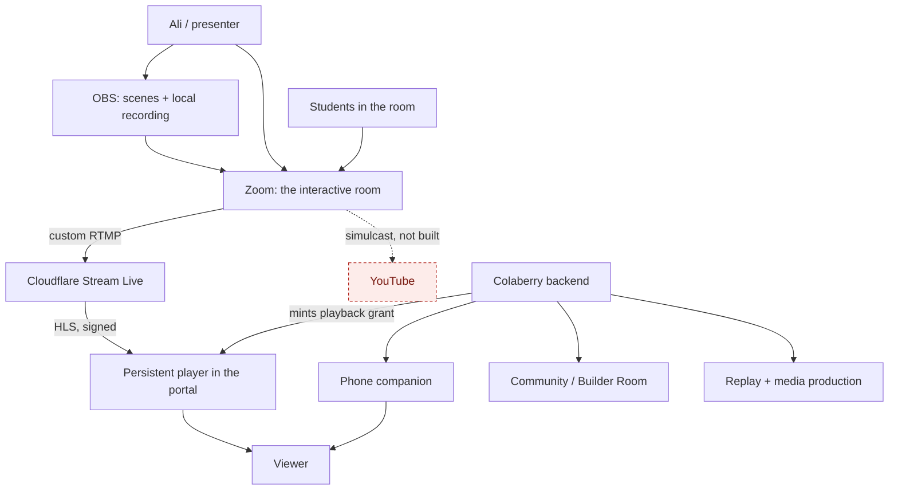
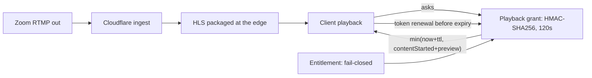
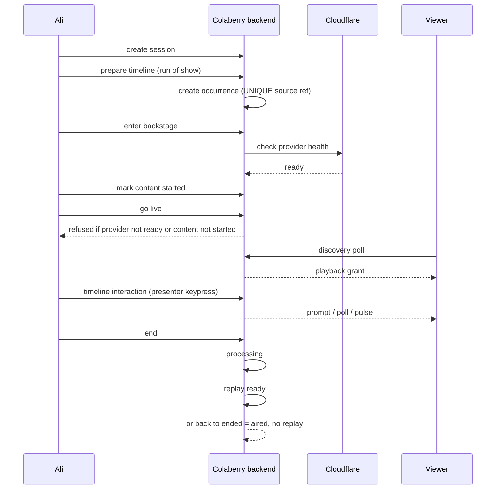
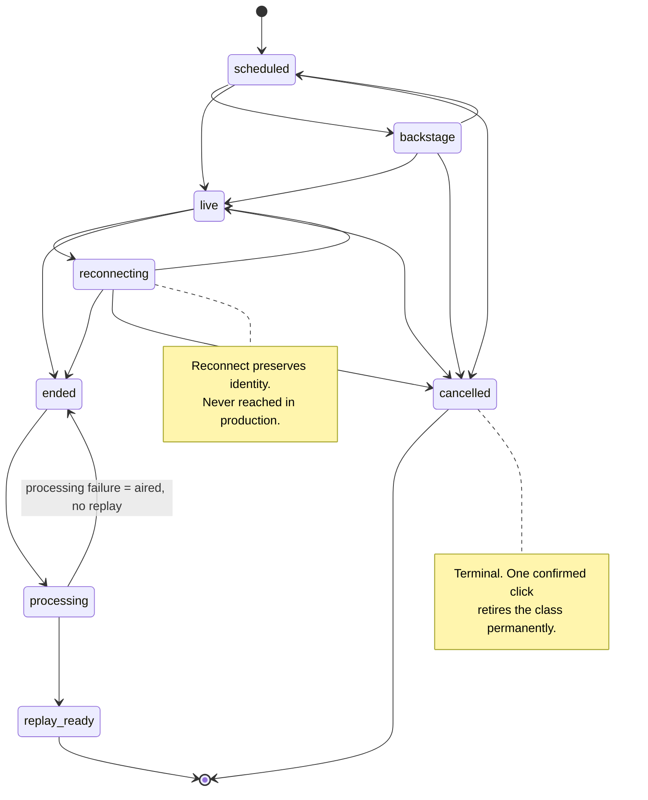
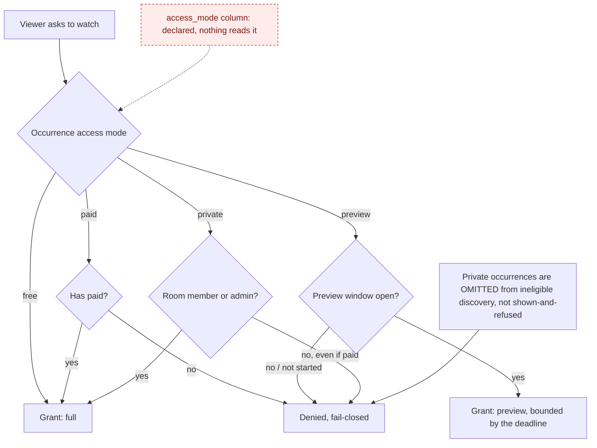
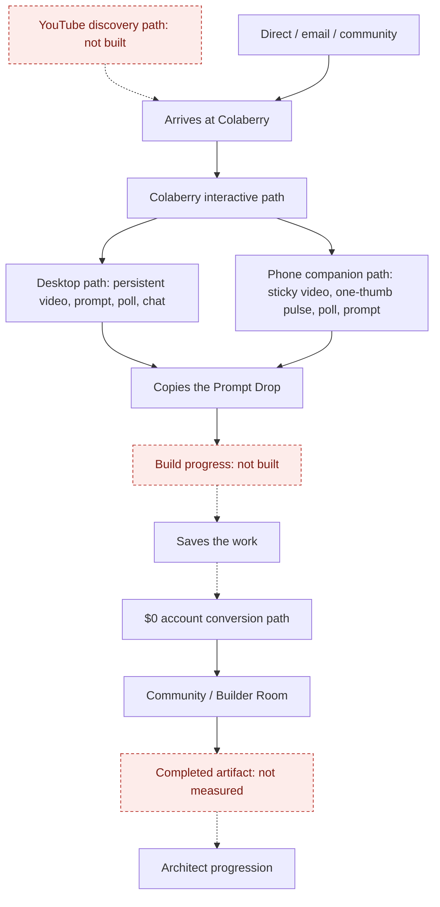
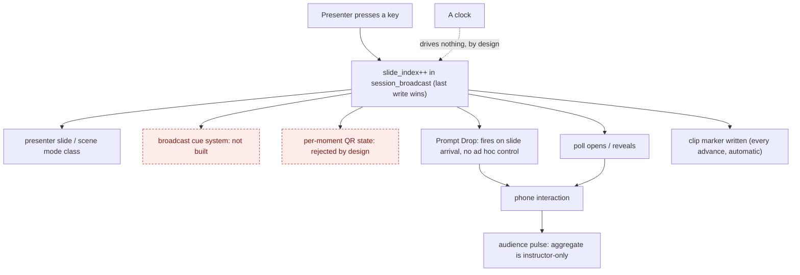
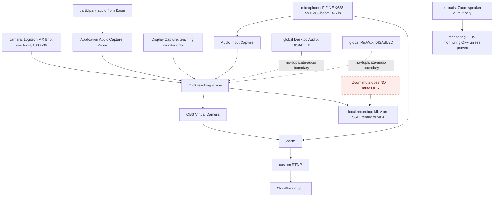
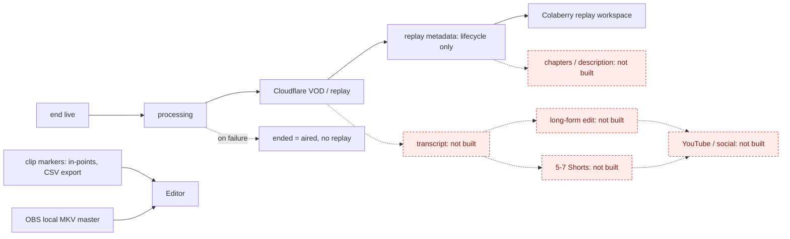
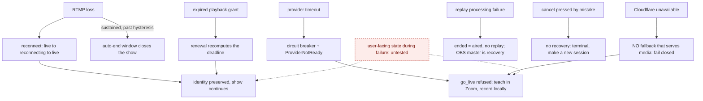

# DOC 12 — Colaberry Live: Architecture Diagrams

> Generated from `scripts/artifacts/tickets/l112Data.js`. **Do not hand-edit** — change the data
> module and re-run `node scripts/artifacts/buildL112Artifacts.js`, which refuses to emit a PDF
> if any diagram failed to render.

| | |
|---|---|
| **Required by** | `docs/requirements/COLABERRY_LIVE_BASECAMP_BOOTSTRAP_v2.md` §3.1 |
| **Basecamp ticket** | L11.2 |
| **Owner** | Ali Muwwakkil |
| **Written** | 2026-11-03 |
| **Start here** | [DOC 00](DOC_00_READ_FIRST_AI_OPERATING_BRIEF.md) · the handbook is [DOC 11](DOC_11_SYSTEM_ARCHITECTURE_HANDBOOK.md) · the contract is [DOC 02](DOC_02_BROADCAST_ARCHITECTURE_AND_SECURITY_CONTRACT.md) |

**10 diagrams, 78 required elements, all checked against the
Mermaid source.** Mermaid is the source of record so the committed document and the rendered PDF
cannot disagree about what the architecture looks like.

## Read this first: a dashed red node does not exist yet

**14 nodes across 7 of these 10
diagrams are drawn dashed and red, because they are not built.** That styling is enforced: the
build fails if a node declared unbuilt is drawn like a working one, and fails again if a node is
drawn unbuilt without being declared.

This matters more than it sounds. A clean box-and-arrow picture of a capability nobody has is the
most persuasive wrong thing this repository could produce, and it would be read as a description of
the system by exactly the people least able to check it. **Diagram 7 is the clearest case: it looks
like an orchestration engine, and there is no timeline runtime at all.**

For what is proven rather than merely built, see DOC 11's capability proof register — 4 of 28
claims have run in a real airing.

## The ten diagrams

1. [System Context Diagram](#1-system-context-diagram)
2. [Live Video Data Flow](#2-live-video-data-flow)
3. [Session-to-Live Sequence Diagram](#3-session-to-live-sequence-diagram)
4. [Broadcast Occurrence Lifecycle Diagram](#4-broadcast-occurrence-lifecycle-diagram) — **needed by DOC 13**
5. [Access and Entitlement Diagram](#5-access-and-entitlement-diagram)
6. [Viewer Experience Diagram](#6-viewer-experience-diagram)
7. [Timeline Orchestration Diagram](#7-timeline-orchestration-diagram)
8. [Studio Signal and Audio Diagram](#8-studio-signal-and-audio-diagram) — **needed by DOC 13**
9. [Replay and Media Pipeline Diagram](#9-replay-and-media-pipeline-diagram)
10. [Failure and Recovery Diagram](#10-failure-and-recovery-diagram) — **needed by DOC 13**

**3 of the ten are the ones DOC 13, the studio operator manual,
needs** (marked above). L0.3 proposed cutting this ticket down to exactly those three; all ten are
built here because scoping cuts are Ali's call, and marking them means the cut is one edit away
rather than a re-derivation.

---

## 1. System Context Diagram

> **1 element(s) in this diagram are not built**, drawn dashed and red. They are requirements, not description.

**What you should learn from this diagram.** Who and what takes part, and where the boundary of our system actually is. Zoom and Cloudflare are outside it — we own the decision about who may watch, not the bytes. YouTube is drawn as not built because nothing publishes to it yet.

---

## 2. Live Video Data Flow

**What you should learn from this diagram.** The 120-second pass is the whole security model. Nothing durable ever reaches the client: the player asks for a new grant before the old one expires, and a viewer who is not entitled simply never gets one, so there is nothing to share.

---

## 3. Session-to-Live Sequence Diagram

**What you should learn from this diagram.** The order operations must happen in, and the two refusals that protect an airing: go_live is refused without provider health, and refused again without a content-start anchor — because going live without the anchor would leave every viewer's free preview unbounded. Note that timeline interaction is a KEYPRESS, not the system advancing.

---

## 4. Broadcast Occurrence Lifecycle Diagram

**What you should learn from this diagram.** Two things nothing else shows as clearly. Reconnect is NOT a restart — the occurrence keeps its identity. And canceling is a one-way door: it is terminal, the session cannot be given another occurrence, and re-scheduling the class writes nothing and reports nothing to whoever did it.

---

## 5. Access and Entitlement Diagram

> **1 element(s) in this diagram are not built**, drawn dashed and red. They are requirements, not description.

**What you should learn from this diagram.** The rule that is easiest to get wrong: paid status never unlocks a private cohort. Money buys the paid tier, not membership of someone else's room. Every unknown path ends in denied, by design — and note that nothing in the product reads access_mode yet, so the tier is decided by other means today.

---

## 6. Viewer Experience Diagram

> **3 element(s) in this diagram are not built**, drawn dashed and red. They are requirements, not description.

**What you should learn from this diagram.** Where the funnel actually breaks. Watching and participating work; the YouTube discovery path does not exist yet, and neither does build progress — so every measure from Build onward is unmeasurable regardless of audience size. That is a bigger hole than any single missing feature.

---

## 7. Timeline Orchestration Diagram

> **2 element(s) in this diagram are not built**, drawn dashed and red. They are requirements, not description.

**What you should learn from this diagram.** The single most important thing to understand about this system: THERE IS NO TIMELINE RUNTIME. Nothing advances on a clock and no producer command touches content — the whole row of consequences below fires because the presenter pressed a key. Read every "the timeline drives X" requirement as "the keypress drives X, when the presenter reaches the slide X was authored onto."

---

## 8. Studio Signal and Audio Diagram

> **1 element(s) in this diagram are not built**, drawn dashed and red. They are requirements, not description.

**What you should learn from this diagram.** The no-duplicate-audio boundaries are the whole point: global Desktop Audio and global Mic/Aux are disabled so a voice is captured once, not twice. And the warning Piyush calls out explicitly — Zoom mute does NOT mute OBS, so a presenter who mutes to cough is still on the local master. None of this hardware is installed yet.

---

## 9. Replay and Media Pipeline Diagram

> **5 element(s) in this diagram are not built**, drawn dashed and red. They are requirements, not description.

**What you should learn from this diagram.** Two of fifteen required outputs exist. The recording binds to its occurrence and clip markers export to CSV — that is the whole of R7 today. Everything dashed is unbuilt, and the seven-phase build plan does not cover any of it, so building P1-P7 to completion still leaves this diagram mostly dashed.

---

## 10. Failure and Recovery Diagram

> **1 element(s) in this diagram are not built**, drawn dashed and red. They are requirements, not description.

**What you should learn from this diagram.** What survives what. Reconnect and grant renewal are real recoveries; a Cloudflare outage has none, and improvising an unsigned URL would give the paywall away permanently — so the correct response is to fail closed and keep teaching in Zoom. The dashed box is the gap: no test asserts what a viewer actually SEES during any of this.
