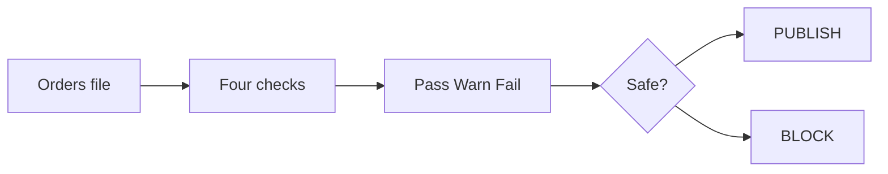
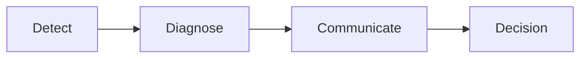

# Your Know-How Is Now a Product

> Your company is about to package what you know into AI skills.

## 1. Header

| | |
|---|---|
| **Promise** | Turn one routine check that lives in one person's head into a Claude skill that fires when someone asks in plain words, then chain it to a second skill that writes the update leadership needs. |
| **Air date** | 2026-11-23 |
| **Audience** | students |
| **Length** | 60 minutes |
| **Curriculum** | Week 2: Agent Skills (build 3 skills) |
| **Beat** | You teach it once, and it never forgets — knowledge stops living in one head. |
| **Academy course** | [Introduction to agent skills](https://anthropic.skilljar.com/introduction-to-agent-skills) (confirmed) |
| **Deliverable** | Your idea, architected and demoed: .claude/skills/ with all 3 Skills committed; A real architecture diagram + tech stack for your idea; A visual mockup + one-pager showing off what it could look like |
| **Story device** | The person who isn't there: an analyst who is out today, so a check nobody else knows how to run does not get run |
| **Lens** | news-consequence |
| **Callback** | No earlier live exists. Callback to the week: you just finished Week 1, where you stopped typing code and started directing Claude Code. Tonight you stop repeating yourself: you teach it a check once. |
| **Series** | Weekly Live · Episode 1 |
| **Scores** | Idea 79/100 · Room 47/50 · Yield 43/50 |

**Assumptions made (no question was asked):**

- Air date 2026-11-23 is the next open slot from history.js next-date: Monday 6:30 pm Central (CST), the schedule Ali confirmed on 2026-11-19 in history.json.
- Planning ran on 2026-11-19, five days before air. News was searched for 2026-11-05 to 2026-11-19 only; ageDays is counted to the air date, so the Fable 5.2 launch (2026-11-09) is 15 days old on air and scored as a 14-90 day story.
- No previous session exists in history (this is Episode 1). The callback is to the student's current week: 'you just finished Week 1'. It says 'last session' nowhere and claims nothing about a prior live.
- students_on is unknown, so every week scored closeness 3 of 5.
- Series defaulted to 'Weekly Live · Episode 1' (history.js episode = 1); it scores the Idea series line as a named episode.
- Demand was gathered only for the top three weeks after the first news pass (2, 5, 3). Other weeks scored a neutral demand 2 (never searched).
- Week 3 demand: Grace Leung's 'Build Your First AI Agent in 20 Minutes' ran 5.0x its channel median but is about Claude Code, not the Claude API, so it was not counted as this topic; week 3 demand held at 3.
- A Frontmost AI press release about Claude Code skills (2026-11-17) was found in search but both copies refused the fetch (HTTP 403 and 429), so it is not a source (listed in newsDropped) and did not lift week 2's news fit.
- Week 2 won the data pick by two points (82 vs 80) over week 5 (MCP), which has fresher main-subject news (Avochato and Rule MCP servers, 7-8 days old) but weaker demand (1.6x vs 4.6x).
- dayKind is architecture (day=architecture, Ali's choice): the session teaches Week 2's Architecture Day incident (monday.tension, realExample and microBuild: data-quality-gate, then executive-dashboard-brief), so the deck uses the Architecture Day template and renders no checkpoint slides.
- Next session is assumed to cover Week 3: Build Your First AI Workflow Assistant (load_curriculum.js next); the 2 AM question is kept as the tease. It is not yet planned.
- No proof= was given, so the Idea proof line is capped at 2 and the session's proof is the live build itself.
- The CTA carries the air time (Monday, 6:30 pm Central): schedule values (air date, next air date, air time, episode, length) are exempt from the public-number check.
- Ali moved the weekly slot to Mondays 6:30 pm CST on 2026-11-19 after planning; air date shifted from 2026-11-24 to 2026-11-23 and news ages recomputed to the new date.

### Why this topic (data pick)

| # | Wk | Theme | Close /30 | Uncovered /20 | Demand /20 | Build /15 | News /15 | Total | Evidence |
|---|---|---|---|---|---|---|---|---|---|
| 1 | 2 | Agent Skills (build 3 skills) | 3 → 18 | 5 → 20 | 5 → 20 | 5 → 15 | 3 → 9 | **82** | Claude for Manufacturing (claude.com, 2026-11-12, 12d) ships 17 skills, a passing mention; Prince Eliot 'CLAUDE SKILLS FULL COURSE 2.5 HOURS' 109,221 views vs 24,000 channel median (4.6x, 2026-09-10); a Nov 17 Frontmost AI skills press release was found but could not be fetched (403/429), so not counted |
| 2 | 5 | MCP Foundations + First MCP Server | 3 → 18 | 5 → 20 | 3 → 12 | 5 → 15 | 5 → 15 | **80** | Avochato Claude connector built as an MCP server (PR Newswire, 2026-11-17, 7d) and Rule MCP server (SMTPedia, 2026-11-16, 8d) are main-subject stories; Claude for Manufacturing connectors (2026-11-12); Tech With Tim 'MCP Servers Explained & Built' 134,547 vs 82,000 median (1.6x); Mikey No Code MCP 23,014 vs 28,500 (below) |
| 3 | 3 | Claude API + Workflow Assistant | 3 → 18 | 5 → 20 | 3 → 12 | 4 → 12 | 3 → 9 | **71** | Self-hosted Managed Agents (2026-11-12) and Claude Meetings (TechCrunch, 2026-11-10): passing; AI Master 'Claude Cowork 2.0 Workflow Automation' 18,032 vs 12,500 median (1.4x); Grace Leung 'Build Your First AI Agent in 20 Minutes' 336,177 vs 67,500 (5.0x) is Claude Code, not the API, so not counted as this exact topic; Austin Marchese 57,471 vs 59,500 (below) |
| 4 | 6 | Advanced MCP + System Integration | 3 → 18 | 5 → 20 | 2 → 8 | 3 → 9 | 3 → 9 | **64** | Xero Xforce FDEs connect workflows to the stack (2026-11-12); Managed Agents MCP credentials: passing |
| 5 | 10 | Governance + Governance Engine | 3 → 18 | 5 → 20 | 2 → 8 | 3 → 9 | 3 → 9 | **64** | Managed Agents allowed hosts (2026-11-12); Manufacturing review-before-send: passing |
| 6 | 8 | Claude Code Workflows + Automation | 3 → 18 | 5 → 20 | 2 → 8 | 3 → 9 | 3 → 9 | **64** | Xero Xforce builds automated workflows (2026-11-12): passing |

Each cell is the 0–5 factor → its weighted points.

Picked week 2: Top-ranked row (82/100), two points clear of week 5. It is the only week with demand at 5: a Claude Skills course ran 4.6x its channel median inside 90 days. Week 5 had the fresher main-subject news (two MCP server launches 7-8 days before air) but its best video ran only 1.6x its median.

### Angles considered

| Lens | Title | Idea | Opening line |
|---|---|---|---|
| build-story | Teach Claude Your Morning Check | 71 | You run a check every morning that only lives in your head. |
| news-consequence ✅ | Your Know-How Is Now a Product | 79 | Your company is about to package what you know into AI skills. |
| mistake-teardown | Why Your AI Skill Never Fires | 72 | You wrote a skill, Claude ignored it, and the description is why. |
| student-journey | When the Analyst Is Out | 70 | The analyst who catches bad numbers is out today, and you're on. |
| contrarian-take | Stop Writing Better Prompts | 72 | You don't need a better prompt; you need one Claude remembers. |

### Tightening log

| Round | Angle | Title | Score | What changed |
|---|---|---|---|---|
| 0 | news-consequence | Your Know-How Is Now a Product | 79 | Starting score, highest of five angles (next: mistake-teardown and contrarian-take at 72). Already above pass mark 70, so no rewrite rounds were spent. Ceiling with this run's evidence is 87 (demand held at 4, proof capped at 2). |

### News and demand behind it

- **Introducing Claude for Manufacturing**, Anthropic (claude.com), 2026-11-12 (11 days old): https://claude.com/blog/claude-for-manufacturing
- **Xforce by Xero: Forward-Deployed Engineers & Partner Consultants to Help Accountants Put AI to Work**, Xero, 2026-11-12 (11 days old): https://www.xero.com/media-releases/xforce-by-xero-forward-deployed-engineers-partner-consultants-help-accountants-put-ai-to-work/
- **Operate Claude Managed Agents inside your security perimeter**, Anthropic (claude.com), 2026-11-12 (11 days old): https://claude.com/resources/articles/self-hosted-claude-managed-agents
- **Anthropic launches Claude Meetings to turn workplace discussions into plans and tasks**, TechCrunch, 2026-11-10 (13 days old): https://techcrunch.com/2026/11/10/anthropic-launches-claude-meetings-to-turn-workplace-discussions-into-plans-and-tasks/
- **Avochato Launches Claude Connector for Agentic Business Texting**, PR Newswire, 2026-11-17 (6 days old): https://www.prnewswire.com/news-releases/avochato-launches-claude-connector-for-agentic-business-texting-302941601.html
- **Rule Launches an MCP Server So AI Assistants Can Draft Campaigns and Automations**, SMTPedia, 2026-11-16 (7 days old): https://smtpedia.com/rule-mcp-server-launch/
- ▶ CLAUDE SKILLS FULL COURSE 2.5 HOURS (Beginner to Expert): @princeeliot, 109221 views vs channel median 24000: https://www.youtube.com/watch?v=-DawhgUKiOg
- ▶ The ONLY Claude Skills Tutorial Beginners Need in 2026 (110 days old, outside the 90-day window, not scored): @100xEngineers, 135903 views vs channel median 25700: https://www.youtube.com/watch?v=TyB7kLZPVKo
- ▶ MCP Servers Explained & Built: @TechWithTim, 134547 views vs channel median 82000: https://www.youtube.com/watch?v=He8tUwLzLnU
- ▶ How Complete Beginners Master Claude Code MCP in 19 minutes: @mikeynocode, 23014 views vs channel median 28500: https://www.youtube.com/watch?v=dhsyihMpqZQ
- ▶ How to Use Claude Cowork 2.0 – Full Workflow Automation Guide 2026: @iamAImaster, 18032 views vs channel median 12500: https://www.youtube.com/watch?v=zo1izxXPbQ4
- ▶ Claude Code: Build Your First AI Agent in 20 Minutes (100% No Coding) (Claude Code, not the API; not counted for week 3): @graceleungyl, 336177 views vs channel median 67500: https://www.youtube.com/watch?v=F8jidmEkIeM

### Stories found but dropped

- ✖ **Frontmost AI releases AEO skills for Claude Code**, openPR: HTTP 403 on fetch (alternate tried: Daily Tribune copy of the same release (URL not recorded): HTTP 429): https://www.openpr.com/news/4691714/frontmost-ai-releases-aeo-skills-for-claude-code-to-help

## 2. Run-of-show

| Start | Min | Mode | Segment |
|---|---|---|---|
| 0:00 | 5 | cold-open | The finished check: BLOCK, with four reasons |
| 0:05 | 8 | teach | Your know-how is now a product: what a skill is |
| 0:13 | 10 | live-build | Build 1: the analyst's check becomes data-quality-gate |
| 0:23 | 8 | teardown | The mistake: a skill that never fires |
| 0:31 | 10 | live-build | Build 2: the update leadership can act on |
| 0:41 | 9 | hot-seat | Hot seat: write the description for your check |
| 0:50 | 10 | recap | Recap: your know-how, written down once |

### 0:00 · The finished check: BLOCK, with four reasons (5 min, cold-open)

- Open on the result: Claude reads a sample orders file nobody has checked, finds four problems, and says BLOCK before the dashboard publishes.
- Callback: you just finished Week 1 and you direct Claude Code now. Tonight you stop repeating yourself and teach it a check once.
- Name the spine once: your know-how is now a product. Tonight you write one piece of it down, so it runs when you are out.

**On screen:** The finished morning-check folder already open in Claude Code; Ali asks in plain words whether the sample orders file is safe to publish and the data-quality-gate report comes back BLOCK (recorded run in tab 2 as backup).
**Chat prompt:** Type one word: what check do you run by hand at work every week?
**Full-screen visual:** Full screen: the data-quality-gate report, four FAIL/WARN rows and a red BLOCK, with a SAMPLE DATA banner across the top.
**Sound bites:** sb-7, sb-12

### 0:05 · Your know-how is now a product: what a skill is (8 min, teach)

- Why now: on November 12 Anthropic introduced Claude for Manufacturing as 17 skills, and Xero introduced Xforce, forward deployed engineers who build AI workflows around how a firm works.
- A skill is a folder with a SKILL.md: a name, a description that says when to use it, and the steps. Claude reads the descriptions and loads the steps only when they are needed.
- Committed in the project, a skill travels with the repo, so the whole team gets the same check, the same thresholds and the same PASS or FAIL language.

**On screen:** No build yet: the two announcement pages side by side, then the what-a-skill-is flowchart.
**Chat prompt:** Poll: the pipeline is green but the dashboard looks wrong. What should happen first?
**Full-screen visual:** The skill-routing flowchart full screen: your question, descriptions scanned, matching skill, steps load, same answer.
**Sound bites:** sb-1, sb-2, sb-8

### 0:13 · Build 1: the analyst's check becomes data-quality-gate (10 min, live-build)

- In a sandbox folder, Claude Code generates a fictional orders file with four planted problems. Sample data only, so we know the right answer before Claude does.
- The description names the trigger in the words an analyst uses; the body is her routine: freshness, duplicate keys, required fields, unreasonable amounts.
- Test it the honest way: ask in plain words, without naming the skill, and watch which skill loads.

**On screen:** Claude Code runs instruction 1: creates morning-check, the SAMPLE DATA orders file with four planted problems and the data-quality-gate skill; Ali asks in plain words and the report finds all four and says BLOCK.
**Chat prompt:** Type READY when your own skills folder exists, or STUCK and a mentor will jump in.
**Full-screen visual:** Split screen: the SKILL.md on the left, the PASS/WARN/FAIL report with BLOCK on the right.
**Sound bites:** sb-10, sb-11

### 0:23 · The mistake: a skill that never fires (8 min, teardown)

- On a throwaway copy, keep the same steps and change only the description to 'Helps with data.' Ask the same plain question.
- Direct invocation proves the steps run; a plain-words question tests whether Claude can tell when the skill applies. A vague description names no trigger and no output.
- Delete the copy: with real skills beside it, the vague one loses. One sentence is the difference between a check that runs and one nobody can find.

**On screen:** Claude Code runs instruction 2: makes the data-helper copy with the vague description, reports whether it loaded on the plain question, then deletes it; data-quality-gate, etl-failure-triage and csv-summary stay.
**Chat prompt:** Diagnostic: it works when you type the slash command but not when you ask in plain words. What do you inspect first?
**Full-screen visual:** Two descriptions side by side, 'Helps with data.' crossed out in red, the trigger-naming description in green beneath it.
**Sound bites:** sb-3, sb-6

### 0:31 · Build 2: the update leadership can act on (10 min, live-build)

- The gate stopped the bad number from publishing. The CFO still needs to know what happened, what it means and who owns it.
- executive-dashboard-brief turns the technical report into status, impact, evidence, decision, owner and next update, in under 150 words.
- Detect, then communicate: two skills, one workflow. Diagnosis (etl-failure-triage) is the third, and it is your build-along.

**On screen:** Claude Code runs instruction 3: creates executive-dashboard-brief, runs the gate again, hands its report to the brief and lists both skills with their descriptions.
**Chat prompt:** Poll: what belongs in the executive update?
**Full-screen visual:** The finished executive brief full screen: status BLOCKED, impact, owner, next update, with the gate report greyed out behind it.
**Sound bites:** sb-4

### 0:41 · Hot seat: write the description for your check (9 min, hot-seat)

- Two volunteers name a check from their own work that would stop running if they were out tomorrow. No real data on screen, only the shape of the check.
- Ali drafts the description live for each: the trigger in their words, the output, and what the skill must never do.
- The job behind this: Xero now pairs firms with forward deployed engineers whose work is turning how a firm runs into AI workflows. You already know how yours runs.

**On screen:** A blank skill card filled in live for each volunteer: name, description (when), steps, output, never-do.
**Chat prompt:** Self-check in chat: name one check that would stop running if you were out tomorrow.
**Full-screen visual:** The filled skill card for the volunteer's check, full screen.
**Sound bites:** sb-9

### 0:50 · Recap: your know-how, written down once (10 min, recap)

- Spine one last time: your know-how is now a product, and tonight you wrote one piece of it down. Detect, diagnose, communicate.
- Build-along: your own three-skill incident workflow on sample data, including etl-failure-triage, each proven by a plain-words question.
- Next session, Week 3: Build Your First AI Workflow Assistant. It is 2 AM and nobody is at the keyboard. Does anything happen at all?

**On screen:** The trust ladder with the Weeks 1-2 rung lit: you approve every single action.
**Chat prompt:** Self-check: from 'I watched' to 'I could build this tonight', where are you?
**Full-screen visual:** The trust ladder full screen with the Weeks 1-2 rung highlighted and the 2 AM question beneath it.
**Sound bites:** sb-5

## 3. Sound bites

| Id | Kind | Score | Segment | Line |
|---|---|---|---|---|
| sb-1 | news-take | 85 | know-how | “Anthropic just shipped manufacturing know-how as 17 skills; your own routine judgment is next, not last.” |
| sb-2 | number | 79 | know-how | “79% of manufacturers still enter data by hand, and every manual check you run is a skill waiting to be written.” |
| sb-3 | mistake | 81 | never-fires | “The biggest mistake you can make is a vague description; 'helps with data' never fires, not once.” |
| sb-4 | framework | 79 | build-brief | “Detect, diagnose, communicate: every incident needs all three, and a skill can run each one for you.” |
| sb-5 | prediction | 85 | recap | “Within a year, your team's best checks will live in skills, not in one person's memory.” |
| sb-6 | contrarian | 79 | never-fires | “You don't need a better prompt; you need one Claude remembers and runs the same way every time.” |
| sb-7 | story-30s | 85 | cold-open | “The analyst is out today, so the check you never wrote down did not run, and revenue looked down 18%.” |
| sb-8 | framework | 81 | know-how | “A skill is only a folder: a name, a description that says when, and the steps you would never skip.” |
| sb-9 | news-take | 73 | hot-seat | “Xero is pairing accounting firms with forward deployed engineers, and you already know the one thing they must learn: how your firm works.” |
| sb-10 | mistake | 75 | build-gate | “Never test a new skill on live company data; a sample file fails safely and costs you nothing.” |
| sb-11 | other | 83 | build-gate | “We built a skill in ten minutes that catches four problems a green pipeline never flagged.” |
| sb-12 | contrarian | 73 | cold-open | “A green pipeline only proves the job ran; it never proved the data was right.” |

**sb-7, the 30-second story:** This is an illustrative scenario from our curriculum. It is 8:05 AM. The executive dashboard says revenue is down 18%. The overnight job says SUCCESS: it ran clean, on schedule, no errors. But the analyst who checks those numbers by hand every morning is out today, and nobody else knows her check. The data has a duplicate order, a missing region and a negative amount. A green job only proves it ran. Her check should not live in her head.

## 4. Slides

### 1. Your Know-How Is Now a Product — title (cold-open)

- Weekly Live · Episode 1
- Tonight one check stops living in one head

**Visual:** Dark slide, a single folder icon with a small tag reading 'when' on it, the title beneath; no logos.

**Speaker note:** Do not read the slide. Say the callback first: you just finished Week 1 and you direct Claude Code now. Then go to the finished report within 30 seconds.
**publicValue:** Episode title card for the edited video

### 2. 8:05 AM. The analyst is out. — story (cold-open)

- Dashboard: revenue down 18% (illustrative)
- Pipeline: SUCCESS
- The person who checks it: out today

**Visual:** A plain card: a clock at 8:05, a green SUCCESS badge, and an empty chair; an ILLUSTRATIVE SCENARIO label in the corner.

**Speaker note:** Tell it as the curriculum's scenario, not a real company. Slow down on 'nobody else knows her check'. Then switch to the finished report in tab 1: this is what the check looks like once it is written down.
**publicValue:** Story Short: the check that did not run

### 3. Know-how is shipping as skills — data (know-how)

- Nov 12: Claude for Manufacturing ships as 17 skills
- Nov 12: Xero pairs firms with forward deployed engineers
- Every manufacturing skill ends with a person's review

**Visual:** Two announcement headlines side by side with their dates, each source URL in small type beneath.

**Speaker note:** Open both source pages live rather than trusting the slide; they were checked on November 19 and must be re-checked on the air date. The point is not the vendors: someone at your company will be asked to write down how a job gets done.
**publicValue:** News clip: know-how is being packaged this month

### 4. What a skill is — teach (know-how)

- A folder with a SKILL.md
- The description says when
- The steps load only when needed

**Visual:** The skill-routing flowchart full screen, the 'Scans descriptions' box outlined in amber.


**Speaker note:** Walk the boxes left to right. Land on 'Scans descriptions': Claude reads every description first and opens a skill only when one matches. That is why the description is the most important line you write tonight.
**publicValue:** Explainer clip: what a Claude skill is, for a non-engineer

### 5. Build 1: data-quality-gate — demo (build-gate)

- Sandbox folder, fictional orders file
- Four planted problems
- Ask in plain words, watch which skill loads

**Visual:** Claude Code on the left running the instruction, the generated SKILL.md on the right.

**Instruction to Claude Code:**

```text
Run these steps yourself — do not print commands for me to copy and paste.
1. Open the morning-check folder (it already holds two prepared skills, etl-failure-triage and csv-summary) and create a sample-data folder inside it.
   # WHY: a sandbox. Nothing in this folder touches a real company system.
2. Generate a fictional orders file for a made-up retailer, about 40 rows: order id, region, revenue amount, load timestamp. Put SAMPLE DATA as the first line. Plant exactly four problems: one duplicate order id, one missing region, one negative revenue amount, and a load timestamp older than 48 hours.
   # WHY: these are the four problems the analyst catches by hand. Planting them means we know the right answer before Claude does.
3. Create a project skill named data-quality-gate in this folder. Description: "Use when the user asks to validate a dataset, CSV, ETL output, query result, or dashboard source before publication." Steps: check freshness, duplicate keys, required fields and unreasonable amounts; give each check PASS, WARN or FAIL with the row that proves it; end with PUBLISH or BLOCK.
   # WHY: the description says when, the steps say how. This is the analyst's morning routine, written down once.
4. Tell me when it is ready and stop. I will ask, in my own words and without naming the skill, whether the orders file is safe to publish.
   # WHY: asking in plain words tests whether the description does its job.
Stop when the report finds all four planted problems and says BLOCK.
```

**Speaker note:** Narrate the decisions, not the characters: why sample data, why four planted problems, why the description is written in an analyst's words. Then ask: is this orders file safe to publish to the revenue dashboard?
**publicValue:** Main build footage: a first Claude skill in a sandbox folder

### 6. The gate decides before anyone sees it — teach (build-gate)

- Four checks, each with evidence
- PASS, WARN or FAIL per check
- One recommendation: PUBLISH or BLOCK

**Visual:** The gate flowchart full screen, BLOCK in red.



**Speaker note:** Point at the evidence column: every FAIL names the row. A check that cannot show its evidence is an opinion. Ask the room to type READY or STUCK before moving on.
**publicValue:** Teaching clip: how a data check decides publish or block

### 7. Break it: 'Helps with data.' — demo (never-fires)

- Same steps, vague description
- Same plain question
- Delete the copy

**Visual:** Split screen: the data-helper SKILL.md with the one-line description, beside Claude's answer showing which skill it used.

**Instruction to Claude Code:**

```text
Run these steps yourself — do not print commands for me to copy and paste.
1. Make a throwaway copy of data-quality-gate called data-helper with the same steps, but set its description to "Helps with data." Leave data-quality-gate, etl-failure-triage and csv-summary in the skills folder.
   # WHY: same steps, vague description. Only the trigger changes, so whatever happens next is the description's doing.
2. Tell me when it is ready and stop. I will ask the same plain question about the orders file.
   # WHY: typing the slash command would prove the steps run. A plain question tests whether Claude can tell when this skill applies.
3. After my question, report which skill loaded, and what in data-helper's description helped or failed to help it compete.
4. Delete data-helper and list the skills that remain.
Stop when data-helper is gone and data-quality-gate, etl-failure-triage and csv-summary remain.
```

**Speaker note:** This is the deliberate failure: data-helper competes with data-quality-gate, etl-failure-triage and csv-summary, so 'Helps with data' should lose. If it fires anyway, say so out loud and compare the two descriptions. Confirm the copy is deleted before moving on.
**publicValue:** High-retention teardown: the description mistake and its fix

### 8. Slash works. Plain words do not. Why? — poll (never-fires)

- Dataset size
- Skill description
- Body length

**Visual:** Three large option tiles plus 'CSV filename'; the vote bars fill as answers arrive.

**Speaker note:** Expect most of the room on the description, and a few on body length. Reveal: the slash command proves the steps can run; a plain question tests whether the description helps Claude recognize when the skill applies.
**publicValue:** Interaction clip: why a skill does not trigger

### 9. Build 2: executive-dashboard-brief — demo (build-brief)

- A second skill for a different reader
- Status, impact, owner, next update
- Two skills, one workflow

**Visual:** Claude Code's finished executive brief on the left, the list of both skills with their descriptions on the right.

**Instruction to Claude Code:**

```text
Run these steps yourself — do not print commands for me to copy and paste.
1. Create a second project skill named executive-dashboard-brief. Description: "Use when a data-quality or incident report must be turned into an update for executives or leadership." Steps: write status, business impact, evidence, decision needed, owner and next update time, in under 150 words, with no SQL and no log lines.
   # WHY: the technical report is right but written for the wrong reader. Leadership needs a decision, not a data dump.
2. Run data-quality-gate on the orders file again, then hand its report to executive-dashboard-brief.
   # WHY: detect, then communicate. Two skills, one workflow, and neither one lives in a person's head.
3. Show me the brief, then list every skill in the folder with its description.
   # WHY: the list is what your teammates will see. If a description is unclear here, it will be unclear to Claude too.
Stop when the brief names the BLOCK decision, an owner and a next-update time in under 150 words.
```

**Speaker note:** Read the brief aloud as if you were the CFO. Ask the room: could you act on this? Then point out that diagnosis, the middle step, is the build-along.
**publicValue:** Payoff footage: two skills turn an incident into a decision

### 10. Detect, diagnose, communicate — teach (build-brief)

- Detection protects the business
- Diagnosis restores the system
- Communication closes the loop

**Visual:** The three-step incident flowchart full screen, Diagnose outlined in dashed amber because it is tonight's build-along.



**Speaker note:** Say who each step is for: detection is for the business, diagnosis for the engineers, communication for leadership. Tonight we built the first and last; the middle one is yours.
**publicValue:** Framework clip: the three skills every incident needs

### 11. Your skill card — quote (hot-seat)

- Which check would stop if you were out?
- When should Claude use it, in your words?
- What must it never do?

**Visual:** A blank skill card with five boxes: name, when, steps, output, never-do.

**Speaker note:** Take two volunteers and fill the card for their check without putting any real data or screens on air. If nobody volunteers, use a month-end invoice check: when the user asks whether invoices are ready to send, check totals, dates and missing purchase orders.
**publicValue:** Hot-seat clip: turning a viewer's routine into a skill

### 12. Written down once — close (recap)

- Your know-how is now a product
- Build-along: your three-skill incident workflow
- Next: Week 3, Build Your First AI Workflow Assistant

**Visual:** The trust ladder with the Weeks 1-2 rung lit, and the next session's question beneath it.

**Speaker note:** Restate the spine in one sentence, read the build-along proof line off the slide, then ask the 2 AM question and stop talking. Leave it open.
**publicValue:** Close and next-live CTA

## 5. Facts and data points

20 facts · 11 sourced · 9 checked · 0 still marked **verify**.

| Id | Claim | Status | Source | Published | Claims registry | Used in |
|---|---|---|---|---|---|---|
| f1 | Anthropic introduced Claude for Manufacturing on 2026-11-12: a plugin with 17 skills and four connectors (Autodesk Fusion, Infor, Microsoft 365, Oracle NetSuite), installed on Team or Enterprise plans. | sourced | [Claude blog: Introducing Claude for Manufacturing](https://claude.com/blog/claude-for-manufacturing) | 2026-11-12 | n/a Third-party product fact; implies no affiliation. | slides.s3, soundBites.sb-1, runOfShow.know-how, contentYield.linkedinPost, contentYield.shorts, angles |
| f2 | Claude for Manufacturing skills are built to end with a user's review, so the person responsible can review and approve the work before it reaches a customer or supplier. | sourced | [Claude blog: Introducing Claude for Manufacturing](https://claude.com/blog/claude-for-manufacturing) | 2026-11-12 | n/a Third-party product fact. | slides.s3, contentYield.linkedinPost |
| f3 | Anthropic's Claude for Manufacturing announcement cites a 2025 Manufacturing Leadership Council survey in which 79% of manufacturers said they manually enter data. | sourced | [Claude blog: Introducing Claude for Manufacturing (citing a 2025 Manufacturing Leadership Council survey)](https://claude.com/blog/claude-for-manufacturing) | 2026-11-12 | n/a Secondary citation of a survey; say 'surveyed manufacturers' on air and open the page live. | soundBites.sb-2, runOfShow.know-how |
| f4 | Anthropic's example: if a steel shipment slips by two weeks, Claude can identify affected customer orders and steel stock at other sites; after the buyer approves, it can release a purchase order to another supplier and reschedule production in Infor. | sourced | [Claude blog: Introducing Claude for Manufacturing](https://claude.com/blog/claude-for-manufacturing) | 2026-11-12 | n/a An example scenario in Anthropic's announcement, told as such, never as a real customer. | participation.storyBeats.b2 |
| f5 | Xero announced Xforce by Xero on 12 November 2026: forward-deployed engineers and partner consultants who help accounting firms redesign workflows for AI, in beta with design partners in Australia, New Zealand and the UK. | sourced | [Xero media release: Xforce by Xero](https://www.xero.com/media-releases/xforce-by-xero-forward-deployed-engineers-partner-consultants-help-accountants-put-ai-to-work/) | 2026-11-12 | n/a Third-party labor-market fact; not a Colaberry outcome claim. | slides.s3, soundBites.sb-9, runOfShow.know-how, runOfShow.hot-seat, contentYield.linkedinPost, angles |
| f6 | Xero's forward-deployed engineers build automated workflows with XeroForce, Xero's APIs and Xero OS, connected to the other software in a firm's stack; firms decide which clients and data the workflows touch. | sourced | [Xero media release: Xforce by Xero](https://www.xero.com/media-releases/xforce-by-xero-forward-deployed-engineers-partner-consultants-help-accountants-put-ai-to-work/) | 2026-11-12 | n/a Third-party fact. | runOfShow.hot-seat, contentYield.linkedinPost |
| f7 | A Claude Code skill is a SKILL.md file with instructions; project skills live at .claude/skills/<skill-name>/SKILL.md and can be committed so the team gets them. | sourced | [Claude Code docs: Extend Claude with skills](https://code.claude.com/docs/en/skills) | — | n/a Product documentation. | slides.s4, soundBites.sb-8, runOfShow.know-how, demo |
| f8 | The skill description helps Claude decide when to load the skill automatically; a user can also invoke a skill directly with /skill-name. | sourced | [Claude Code docs: Extend Claude with skills](https://code.claude.com/docs/en/skills) | — | n/a Product documentation. | slides.s4, slides.s7, slides.s8, soundBites.sb-3, participation.questions.q3, participation.questions.q4 |
| f9 | A skill's body loads only when it is used; in a regular session only the descriptions are in context. | sourced | [Claude Code docs: Extend Claude with skills](https://code.claude.com/docs/en/skills) | — | n/a Product documentation. | slides.s4, runOfShow.know-how |
| f10 | allowed-tools lists tools Claude can use without asking permission during the turn that invokes the skill; it does not restrict which tools are available. | sourced | [Claude Code docs: Extend Claude with skills](https://code.claude.com/docs/en/skills) | — | n/a Product documentation. | participation.questions.q7 |
| f11 | Week 2 is Agent Skills (build 3 skills); beat 'You teach it once, and it never forgets'; deliverable .claude/skills/ with all 3 Skills committed plus an architecture diagram and mockup; Academy course Introduction to agent skills. | ✔ checked 2026-11-19: `backend/src/data/canonicalCourse.ts:192`, `backend/src/data/canonicalCourse.ts:196`, `docs/training-program-2026-q3/TWELVE_WEEK_STORY_ARC.md:118`, `backend/src/data/classSessionPlan.ts:664` | backend/src/data/canonicalCourse.ts, backend/src/data/classSessionPlan.ts, docs/training-program-2026-q3/TWELVE_WEEK_STORY_ARC.md | — | n/a Curriculum fact from the repo. | header.week, students, slides.s12 |
| f12 | The 8:05 AM incident: the dashboard says revenue is down 18%, the ETL job says SUCCESS, the analyst is out, and the data holds a duplicate order id, a missing region, a negative amount and a load timestamp older than 48 hours. | ✔ checked 2026-11-19: `backend/src/data/classSessionPlan.ts:486` · _illustrative_ | backend/src/data/classSessionPlan.ts (Week 2 monday.tension) | — | n/a Labeled teaching scenario; shown only with a visible 'illustrative' label. | soundBites.sb-7, slides.s2, slides.s5, participation.storyBeats.b1, runOfShow.cold-open |
| f13 | The description examples 'Helps with data' (never fires) and 'Use when the user asks to validate a dataset, CSV, ETL output, query result, or dashboard source before publication' (fires reliably), and the three skills data-quality-gate, etl-failure-triage and executive-dashboard-brief. | ✔ checked 2026-11-19: `backend/src/data/classSessionPlan.ts:490`, `backend/src/data/classSessionPlan.ts:491`, `backend/src/data/classSessionPlan.ts:495` | backend/src/data/classSessionPlan.ts (Week 2 realExample, architectureBeats) | — | n/a Curriculum teaching material. | slides.s5, slides.s7, slides.s9, soundBites.sb-3, demo |
| f14 | Week 3's 2 AM question: 'It's 2 AM and nobody is at the keyboard. Does anything happen at all?' | ✔ checked 2026-11-19: `docs/training-program-2026-q3/TWELVE_WEEK_STORY_ARC.md:70` | docs/training-program-2026-q3/TWELVE_WEEK_STORY_ARC.md | — | n/a Curriculum device; next session's topic is an assumption. | students.openQuestion, runOfShow.recap, slides.s12, contentYield.nextLiveCta |
| f15 | Trust ladder, Weeks 1-2: 'You approve every single action'. | ✔ checked 2026-11-19: `docs/training-program-2026-q3/TWELVE_WEEK_STORY_ARC.md:90` | docs/training-program-2026-q3/TWELVE_WEEK_STORY_ARC.md | — | n/a Curriculum device. | participation.storyBeats.b4, slides.s12, runOfShow.recap |
| f16 | Series name 'Weekly Live · Episode 1'. | ✔ checked 2026-11-19: `.claude/skills/plan-live-session/SKILL.md:94`, `.claude/skills/plan-live-session/scripts/history.js:93` | Skill default series name: plan-live-session SKILL.md (series default) and history.js episode = 1 | — | n/a Out of registry scope; an internal series label. | header.series, slides.s1 |
| f17 | Air date Monday 2026-11-23, 6:30 pm Central (CST); next session Monday 2026-11-30. | ✔ checked 2026-11-19: `Ali confirmed 2026-11-19` | history.json schedule (confirmed by Ali 2026-11-19) and history.js next-date | — | n/a Schedule, not a public claim. | header.airDate, checklist, contentYield.nextLiveCta |
| f18 | The program is the Forward Deployed AI Engineer Accelerator. | ✔ checked 2026-11-19: `backend/src/data/canonicalCourse.ts:145` | backend/src/data/canonicalCourse.ts (curriculum engine prompt) | — | **not registered** not registered. Program name kept out of public copy until registered. | students.applyToOwnPlan |
| f19 | Claude Code is an Anthropic product (named in the Fable 5.2 announcement as a surface where fast mode is available); we build on Claude and Claude Code. | sourced | [Anthropic: Introducing Claude Fable 5.2 and Claude Mythos 5.2](https://www.anthropic.com/news/claude-fable-and-mythos-5-2) | 2026-11-09 | `anthropic.capability` VERIFIED, approved for all routes ('We build on Claude and Claude Code.'). Never phrase as a partnership: anthropic.partner is DO_NOT_PUBLISH. | slides, demo, contentYield |
| f20 | The sample orders file, the morning-check folder, the planted problems, the prepared competitor skill csv-summary and the month-end invoice fallback example are fictional teaching material created for the demo. | ✔ checked 2026-11-19: `blueprint:demo.claudeCodeInstructions[0]`, `blueprint:slides[10].speakerNote` · _illustrative_ | This blueprint's own sandbox design (demo instruction 1, hot-seat fallback note) | — | n/a Illustrative; shown on air under a visible SAMPLE DATA label. | demo, slides.s5, slides.s11 |

## 6. Participation

- **[roll-call] Where are you watching from, and what kind of check do you run by hand at work?** (cold-open)
  - Options: Numbers and reports · Customer records · Invoices and payments · Something else
  - Answer: No right answer. Read three out loud and keep them for the hot seat.
- **[judgment-poll] The ETL run is green, but the dashboard looks wrong. What should happen first?** (know-how)
  - Options: Rebuild the dashboard · Rerun the entire ETL pipeline · Validate the output against its data-quality contract · Ask leadership which number looks suspicious
  - Answer: Validate the output against its data-quality contract. A green pipeline proves the job ran; it does not prove the data is trustworthy.
- **[diagnostic] Which part helps Claude recognize when a skill is relevant?** (build-gate)
  - Options: Folder name · Description · Body length · Creation date
  - Answer: Description. Claude scans the descriptions to decide when to load a skill; the description is the routing logic, not documentation.
- **[diagnostic] The skill works when you type /data-quality-gate, but not when you ask 'Is this dataset safe to publish?' What do you inspect first?** (never-fires)
  - Options: Dataset size · Skill description · Body length · CSV filename
  - Answer: Skill description. Direct invocation proves the steps run; a plain-words question tests whether the description helps Claude recognize when the skill applies.
- **[judgment-poll] What belongs in the executive update?** (build-brief)
  - Options: The entire pipeline log · Every SQL statement tested · Status, impact, evidence, decision, owner and next update · A general note that IT is investigating
  - Answer: Status, impact, evidence, decision, owner and next update. Leadership needs a decision product, not a technical data dump.
- **[self-check] Name one check that would stop running if you were out tomorrow. How ready is it to become a skill?** (hot-seat)
  - Options: I have not thought of one yet · I know the check but not the words · I could write its description now · I already wrote it down
  - Answer: A good answer names a specific check, the words a colleague would use to ask for it, and the one thing it must never do (for example, send anything without a person approving).
- **[diagnostic] What does allowed-tools in a skill do?** (recap)
  - Options: Permanently restricts the skill to those tools · Pre-approves the named tools for the turn that invokes the skill · Prevents automatic invocation · Loads every reference file
  - Answer: Pre-approves the named tools for the turn that invokes the skill. It does not restrict which tools are available; permission settings still govern the rest.
- **[self-check] From 'I watched' to 'I could build this tonight', where are you?** (recap)
  - Options: I watched · I could follow it · I could build it with the three instructions · I could build it from memory
  - Answer: Any honest answer is right. 'With the three instructions' is this week's target; 'I watched' means start the build-along with instruction 1 tonight.

### Story beats

- **An analyst at a retailer, in the curriculum's illustrative incident** (cold-open, the person who isn't there): 8:05 AM: the dashboard says revenue is down 18% and the overnight job says SUCCESS, but she is out today and nobody else knows her morning check. *Stake:* A wrong revenue number reaches the executive team before anyone notices the duplicate order and the negative amount. **She should not be the control. The check should.**
- **A buyer at a manufacturer, in Anthropic's own Claude for Manufacturing example** (know-how): A steel shipment slips two weeks, and Claude finds the affected customer orders and the steel stock at other sites. *Stake:* Claude can release a purchase order to another supplier, but only after she approves it. **The know-how is packaged. The decision stays hers.**
- **A CFO waiting on the incident, in the curriculum's illustrative scenario** (build-brief): The data team has a correct technical report full of row numbers and timestamps, and the CFO has a board call in an hour. *Stake:* A right answer in the wrong shape means the decision gets made without it. **A technically correct answer can still be the wrong communication product.**
- **You, last week in Week 1** (recap, the trust ladder): You approved every single action Claude took, one click at a time. *Stake:* Tonight it ran a check you wrote once, and it still waited for you before anything was published. **Teach it once. Still approve every time, for now.**

## 7. Live demo plan

**Goal:** In a sandbox folder that holds two prepared skills (etl-failure-triage and csv-summary), turn the analyst's morning check into a data-quality-gate skill on a fictional orders file, break it with a vague description and restore it, then add executive-dashboard-brief so one plain-words question ends in a decision leadership can act on.

1. Before the show: create etl-failure-triage and csv-summary in the morning-check folder's skills (prepared, not built live; csv-summary describes a CSV's columns and row counts), so the teardown has real competition.
2. Cold open: show the finished BLOCK report from the prepared folder (recorded run ready in tab 2).
3. Build 1: Claude Code creates morning-check, the SAMPLE DATA orders file with four planted problems and data-quality-gate; Ali asks in plain words whether the file is safe to publish.
4. Teardown: a throwaway data-helper copy with the description 'Helps with data.'; ask the same question, report which skill loaded (data-helper competes with data-quality-gate, etl-failure-triage and csv-summary), then delete it.
5. Build 2: Claude Code creates executive-dashboard-brief, runs the gate again and hands its report to the brief.
6. Close the loop: list every skill with its description and confirm data-helper is gone.

**What I tell Claude Code:**

```text
Run these steps yourself — do not print commands for me to copy and paste. In the morning-check folder (it already holds two prepared skills, etl-failure-triage and csv-summary), create a sample-data folder, generate a fictional retailer orders file with SAMPLE DATA on the first line and exactly four planted problems (a duplicate order id, a missing region, a negative revenue amount, a load timestamp older than 48 hours), and create a project skill named data-quality-gate with the description 'Use when the user asks to validate a dataset, CSV, ETL output, query result, or dashboard source before publication.' and steps that give PASS, WARN or FAIL per check with evidence and end with PUBLISH or BLOCK. Then stop and wait for my question.
```

```text
Run these steps yourself — do not print commands for me to copy and paste. Make a throwaway copy of data-quality-gate called data-helper whose description is only 'Helps with data.', leave data-quality-gate, etl-failure-triage and csv-summary where they are, and wait for my question. After it, report which skill loaded and why data-helper did or did not, then delete data-helper and list the skills that remain.
```

```text
Run these steps yourself — do not print commands for me to copy and paste. Create a project skill named executive-dashboard-brief with the description 'Use when a data-quality or incident report must be turned into an update for executives or leadership.' that writes status, impact, evidence, decision, owner and next update in under 150 words, run data-quality-gate on the orders file, hand its report to the brief, show the brief and list every skill with its description.
```

**What could go wrong:**

- The vague 'Helps with data.' skill fires anyway even with data-quality-gate, etl-failure-triage and csv-summary beside it: say so, read the two descriptions side by side, and explain that a team folder with twenty skills makes the collision worse, not better.
- Claude Code does not pick up a new skill until a new message or session: ask it to confirm the skill is listed before asking the question.
- The generated sample data has five problems or three, not four: ask Claude Code to list the planted problems before the build, and regenerate if the count is wrong.
- The generated data uses a real company name: regenerate with obviously fictional names before going live.
- The brief runs long or includes log lines: point at the 150-word rule in the description and have Claude Code tighten the skill, which is itself the lesson.

**Fallback:** Tab 2 holds a recorded run of all three instructions against the same sample data, a saved copy of the finished morning-check folder, and screenshots of the BLOCK report and the executive brief. If any build stalls past two minutes, switch to the recording and narrate it.

## 8. For the students

**Build-along:** Rebuild tonight's workflow on a sample file you generate, never real data: data-quality-gate, executive-dashboard-brief, and etl-failure-triage, which sat prepared in tonight's folder but was not built live; it reads the run's log and ranks the likely causes with evidence. Prove each skill fires from a plain-words question, not the slash command, and commit all three to .claude/skills/.

**Apply it to your own build plan:** Your generated build plan arrives in Week 3. Before then, write down the one check from your own job that would stop running if you were out tomorrow, and draft its description in the words a colleague would use to ask for it. Bring it to the next session; it becomes the first skill in your own plan.

**The open question:** Your skills run when you ask. It's 2 AM and nobody is at the keyboard. Does anything happen at all?

## 9. Content yield

**Edited video (18-24 (edit path: cold open, know-how, Build 1, teardown, Build 2, recap; hot seat cut to one volunteer) min):** Your Know-How Is Now a Product · thumbnail: **PACKAGED**

> You run a check at work that lives only in your head, and the day you are out, it does not run. In this video you will turn that check into a Claude skill that runs the same way every time, and see the one mistake that makes a skill never fire.

| Short | Sound bite | Segment |
|---|---|---|
| Your know-how is the next AI product | sb-1: “Anthropic just shipped manufacturing know-how as 17 skills; your own routine judgment is next, not last.” | know-how |
| The skill mistake that means it never fires | sb-3: “The biggest mistake you can make is a vague description; 'helps with data' never fires, not once.” | never-fires |
| Stop writing better prompts | sb-6: “You don't need a better prompt; you need one Claude remembers and runs the same way every time.” | never-fires |
| A green pipeline proves less than you think | sb-12: “A green pipeline only proves the job ran; it never proved the data was right.” | cold-open |
| Never test AI on live company data | sb-10: “Never test a new skill on live company data; a sample file fails safely and costs you nothing.” | build-gate |
| Where your team's best checks will live | sb-5: “Within a year, your team's best checks will live in skills, not in one person's memory.” | recap |

**Quote cards:**

- “A skill is only a folder: a name, a description that says when, and the steps you would never skip.”
- “Detect, diagnose, communicate: every incident needs all three, and a skill can run each one for you.”
- “A green pipeline only proves the job ran; it never proved the data was right.”

**LinkedIn post:**

Two announcements on November 12 point the same way.

Anthropic introduced Claude for Manufacturing as 17 skills, each built to end with a person's review. Xero introduced Xforce, which pairs accounting firms with forward deployed engineers who build AI workflows around how each firm works.

Know-how is being packaged.

The routine checks you run every week are exactly what gets packaged next. The only question is who writes them down.

In our next weekly live we write one down. A morning data check that only one analyst knows how to run becomes a Claude skill: a name, a description that says when to use it, and the steps she would never skip. Then we break it on purpose with a one-line description that never fires, and fix it.

Detect. Diagnose. Communicate.

Bring one check from your own job that would stop running if you were out tomorrow. We will draft its description live.

**Email:** Your know-how, written down once

We turned a morning data check that lived in one analyst's head into a Claude skill, broke it with a vague description, fixed it, and chained it to a brief leadership can act on. Your build-along: write the missing diagnosis skill and draft the description for one check from your own job.

**Next live CTA:** Next live, Monday, 6:30 pm Central (November 30): Week 3, Build Your First AI Workflow Assistant. It's 2 AM and nobody is at the keyboard. Does anything happen at all? Bring the check you named tonight.

## 10. Scores

- **Idea:** 79/100 (pass mark 70)
- **Room:** 47/50 (coldOpen 10 · pace 9 · participation 9 · buildCredibility 10 · studentRelevance 9)
- **Yield:** 43/50 (clipDensity 9 · shortsReadiness 9 · longFormPath 8 · titleAndThumbnail 8 · distributionPack 9)

**The two fixes worth the most points:**

1. Supply proof=: a real deployed skill (Ali's own or a learner's, with permission) on screen lifts the Idea proof line from 2 to 4 or 5, worth +6 to +9 Idea points.
2. Find demand on this exact angle: a video about packaging work know-how into skills that ran 3x its channel median lifts the Idea demand line from 4 to 5, worth +4 Idea points.

## 11. Pre-show checklist and risks

- [ ] No keys, client data or student data on screen
- [ ] News sources re-checked on the air date
- [ ] Clip-marker button tested
- [ ] Fallback tab open: recorded run of all three instructions plus the finished morning-check folder
- [ ] Sandbox reset: morning-check holds only the two prepared skills, and the sample data is regenerated with obviously fictional names
- [ ] Sandbox prepared: etl-failure-triage and csv-summary created in the morning-check skills folder before the show (the teardown's routing competitors), and no other skills
- [ ] Both announcement pages (Claude for Manufacturing, Xforce by Xero) open in tabs for slide s3
- [ ] Zoom/YouTube link posted; Monday 2026-11-23, 6:30 pm Central (CST)

**Risks:**

- The teardown can silently succeed: if 'Helps with data.' still fires with data-quality-gate, etl-failure-triage and csv-summary in the folder, say so out loud, read the two descriptions side by side, and name the trigger the vague one lacks.
- News is 12 days old on the air date; if a fresher skills or forward deployed story lands, swap it into slide s3 and the LinkedIn post.
- The 79% figure is Anthropic's citation of a 2025 survey, not a primary source; open the page live and say 'surveyed manufacturers'.
- The 8:05 AM incident and its 18% are illustrative; say so on air and never put them in public copy without the label.
- Viewers may hear 'Anthropic' and assume a partnership; never imply one (anthropic.partner is DO_NOT_PUBLISH).

## 12. Deck handoff (for build-class-deck)

Session: **Your Know-How Is Now a Product** · public title "Your Know-How Is Now a Product" · week 2

| Segment id | Start–End | Mode | Label | publicValue |
|---|---|---|---|---|
| cold-open | 0–5 | open | The finished check | Cold open |
| know-how | 5–13 | present | Your know-how is now a product | Explainer clip |
| build-gate | 13–23 | build | Build 1: data-quality-gate | Main build footage |
| never-fires | 23–31 | build | The skill that never fires | High-retention sequence |
| build-brief | 31–41 | build | Build 2: the executive brief | Payoff footage |
| hot-seat | 41–50 | interact | Hot seat: your skill card | Hot-seat clip |
| recap | 50–60 | close | Written down once | Next-live CTA |

Teach slides: 7 · slideNotes: 21 · interactions: 8 · story beats: 3

**Fields that could not be mapped (not guessed):**

- `runOfShow segment times`: The deck scales the fixed 120-minute Architecture Day template to the session length; the blueprint's custom start/end minutes are not carried.
- `hook`: Architecture Day shows the authored Week 2 hook ('The ETL job says SUCCESS. The revenue number is wrong.') before the cold open; kept, because it is tonight's incident. Commentary in slideNotes hook:cold-open--1.
- `template content slides`: business-problem (the 8:05 AM incident), architecture (Week 2's three-skill diagram), deconstruct (the two descriptions) and micro-build render from Week 2's authored Architecture Day content; their commentary is in slideNotes.
- `reset segment`: No blueprint content; renders as template default (break slide). slideNotes tells the presenter to skip it.
- `hot-seat segment`: Architecture Day has no slide of its own in challenge; the hot seat runs on its self-check poll (challenge-950), whose note carries the commentary.
- `trailer slide`: Renders 'Thursday we make it work' with the authored Week 2 Thursday trailer; slideNotes cta:trailer-0 reframes it as tonight's close and the Week 3 open loop.
- `checkpoints (CP0-CP3)`: Architecture Day renders no checkpoint slides; checkpointsEnabled false has no effect.
- `story beat b4 (recap)`: Architecture Day renders story beats only in checkin, business-problem, architecture, deconstruct and micro-build; b4's line is carried in slideNotes cta:trailer-0.
- `slides s1 (title), s2 (story), s8 (poll), s11 (quote), s12 (close)`: Generated slides on the deck (cover, story beat, interaction, challenge poll, trailer); their commentary is carried in slideNotes, their bullets are not.
- `publicEndsAtMinute`: Not set (audience=students); the deck has no field for it.
- `contentYield`: Video, Shorts, quote cards, LinkedIn, email and CTA are not deck content.
- `per-slide publicValue`: The deck reads publicValue per run-of-show segment, not per slide.

The full KitConfig-shaped payload is in `blueprint.json` under `deckHandoff`.
