# Before and after

The same sample data rendered two ways. **Before** is the current Connected Demo engine. **After** is the hand-built target in `reference/shiftfill-coverage-console.html`.

Use these pairs to learn the transformation, not the domain. Rule numbers refer to the detection rules table in `PROMPT.md` (row order) and its guards. `after/08-activity.png` shows the filterable activity log.

## 1. Home screen

**Before:** Three count tiles, then full-text approval cards and a text feed. The reader has to read every card to learn what happened this morning. (`before/02-home-lower.jpg` shows the rest: a plain table.)

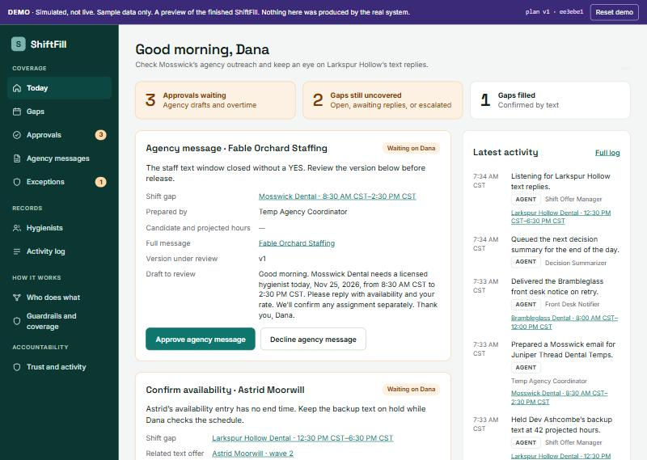

**After:** Tiles first, including two measured against their targets. Then one picture of the whole morning: a lane per work item, a now line, event marks, reply windows and shift starts. Decisions sit beside a funnel per work item. The feed moves to the bottom.

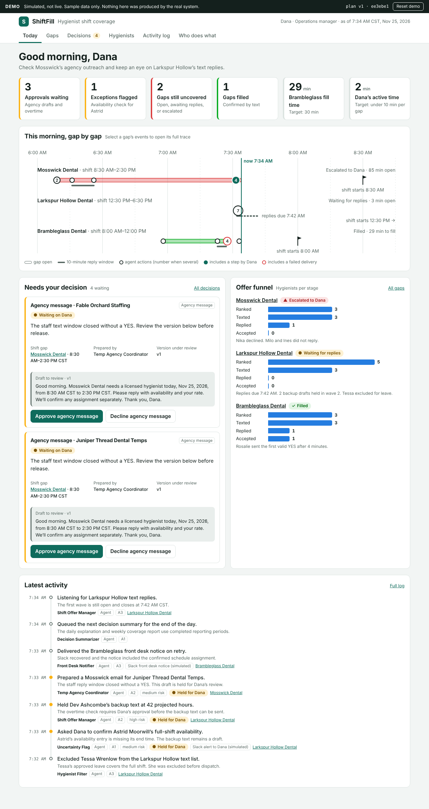

**Rule applied:** Rules 1, 2, 3, 4, 8 and the home composition order

## 2. List screen

**Before:** A table with thin meters and no target. 85 min and 29 min look alike; nothing says the target is 30.

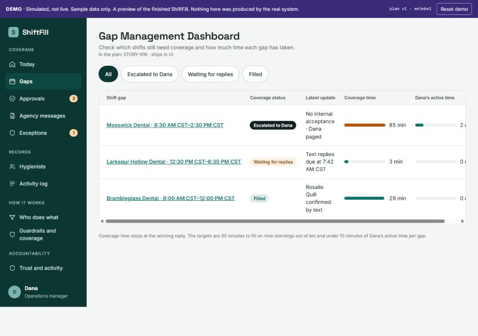

**After:** Each meter prints value and target together and changes form when over target. Below the table, each work item gets a path of steps with the minutes between steps, so the 64-minute wait is visible at a glance.

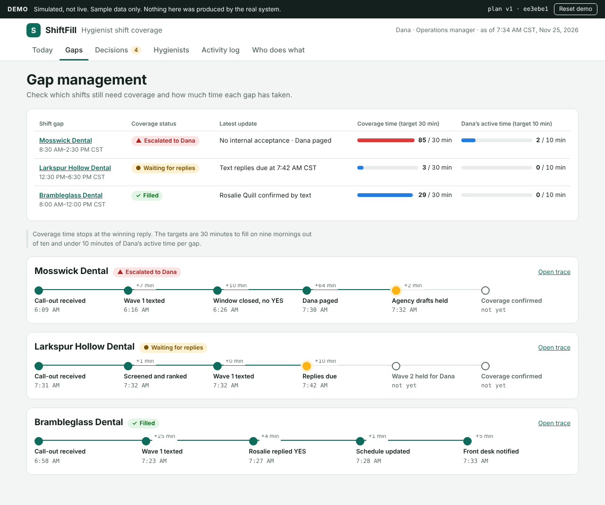

**Rule applied:** Rules 2 and 5

## 3. Record detail

**Before:** Two tables (decisions, activity) and a fact list. Candidates, their hours and the offers are on other pages.

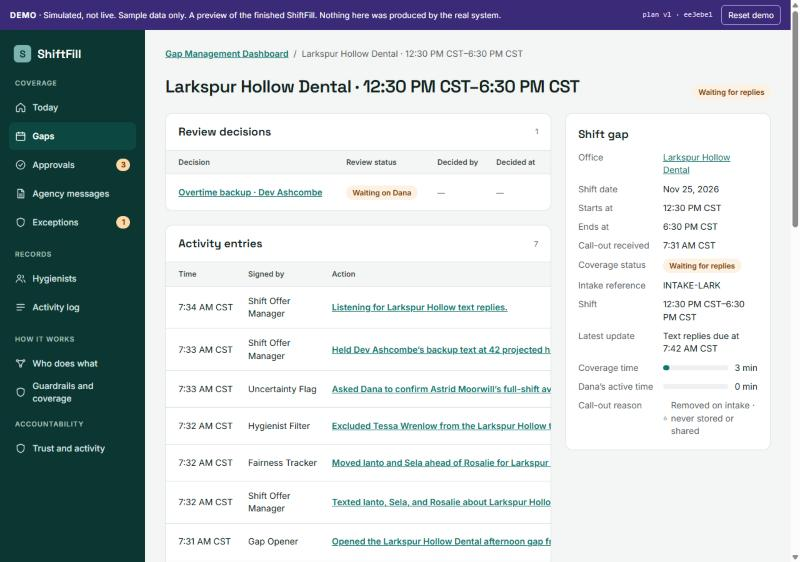

**After:** Facts, the path so far, the decisions for this record with working buttons, then child rows as bars against the 40-hour limit beside the funnel and the messages sent, then the event trace with actor, tier, risk and held state.

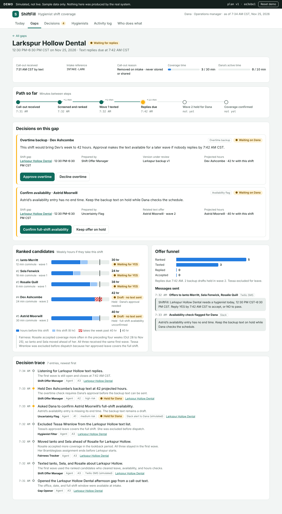

**Rule applied:** Rules 2, 4, 5, 6, 8 and the record-detail composition

## 4. People list

**Before:** A table with hours as text. The reader compares nine numbers by reading them.

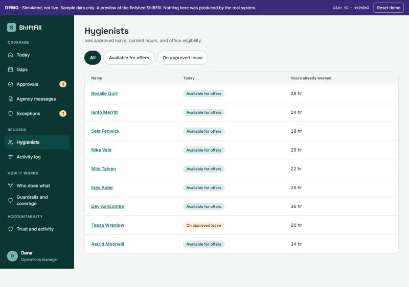

**After:** The shared numeric field becomes bars with a limit line; status stays a pill with icon and label; the join entity (person by office with a number) becomes a matrix.

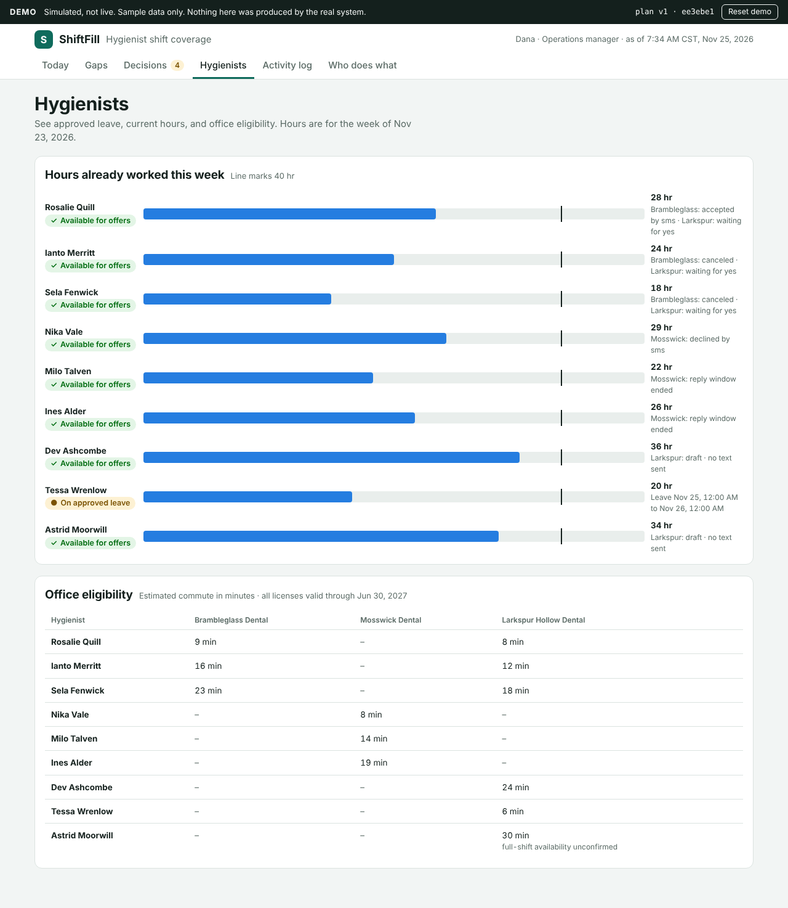

**Rule applied:** Rules 3, 6 and 7

## 5. Who does what

**Before:** Says "The plan names no agents" although the activity log names twelve.

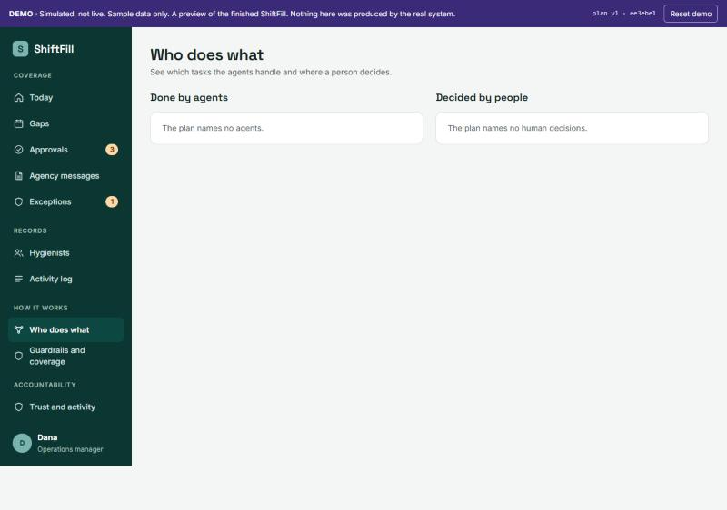

**After:** Built from the events: summary tiles, one stacked bar of actions by autonomy tier, the agent roster with counts and held or failed flags, the decisions made by people, connections used and requirement ids cited.

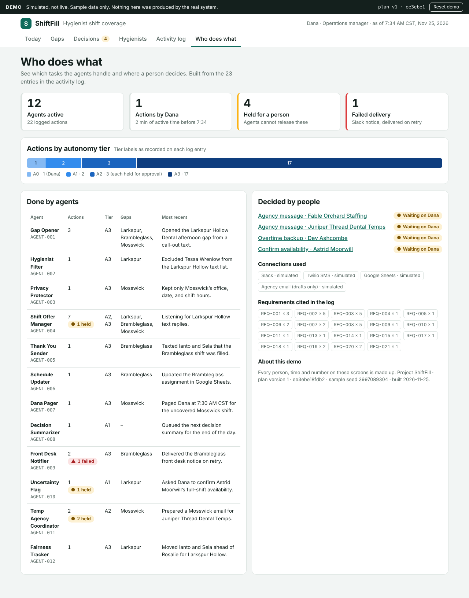

**Rule applied:** Rule 9 and guard 4 (never show an empty state the data contradicts)

## 6. Decisions (new merged view)

**Before:** Approvals, agency messages and exceptions are three separate menu items showing overlapping items.

**After:** One filterable queue of decision cards: why it needs a person, the facts, the exact content under review, primary and secondary action.

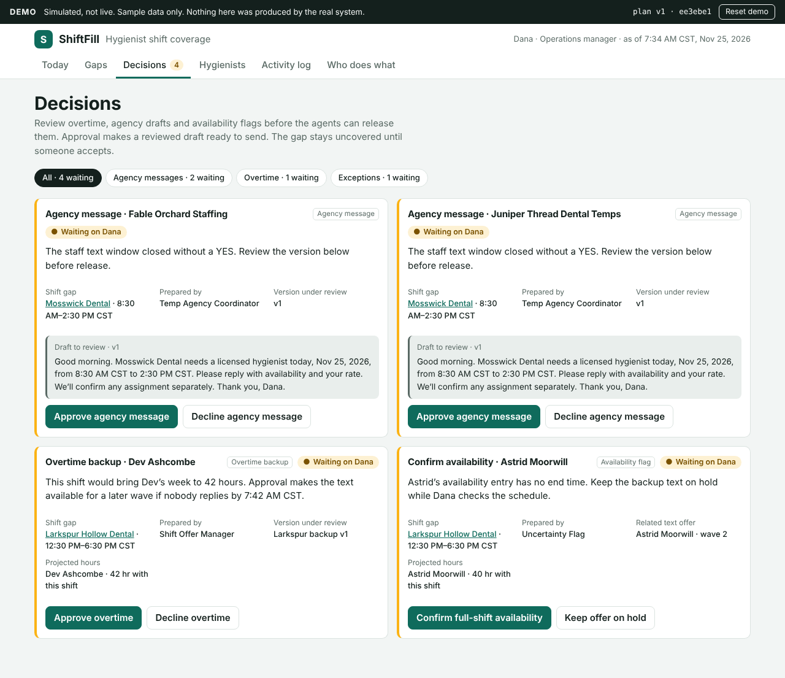

**Rule applied:** Rule 8
