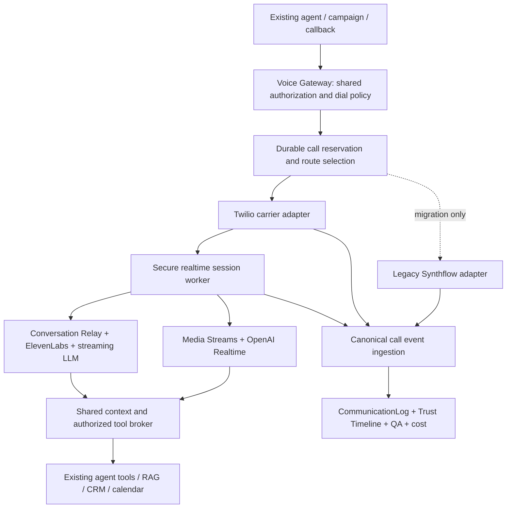

# Colaberry Voice AI Studio — master Claude Code implementation directive

**Mission:** Replace Synthflow end to end with a Colaberry-owned voice orchestration platform, directly inside `ColaberryIntern/ColaberryEnterprise_AI_LeadershipAccelerator`. Build, test, document and migrate it; do not merely produce a plan.  
**Owner:** Colaberry engineering / Kes. **First migration:** Edu: Cory - Outbound.  
**Authorized live test destination:** `[REDACTED: VOICE_TEST_ALLOWED_NUMBER]`[REDACTED: VOICE_TEST_ALLOWED_NUMBER]). Store this in a protected environment setting, never in application source, public fixtures, screenshots, commits or logs. This directive contains the number for private handoff only; redact it before committing this document to the public repository.  
**Production target:** No operational dependency on Synthflow after verified migration and explicit cutover approval.  
**Execution mode:** Existing repository conventions, incremental releases, evidence-driven gates. No production customer calls, number purchases, porting, subscription cancellations or live routing changes without appropriate owner approval. The supplied test number is authorized for bounded internal test calls only.

---

## 0. Operating contract — read before making changes

You are the lead architect, senior TypeScript engineer, telephony engineer, QA lead, product designer, security reviewer and release engineer. Use specialized subagents if available, but one orchestrator owns the final integration. Do the work, not just describe it.

1. Read the repository's CLAUDE.md, nested instructions, release workflows, Story-000 conventions, Project Factory, architecture and test conventions. Honor more specific repo rules. Inspect `git status`, current branch, commit, worktrees and deployment topology. Do not discard unrelated changes. Work on a dedicated feature branch/worktree; keep PRs reviewable. Never push directly to main or deploy without the project's approvals.
2. Create a durable working folder `docs/voice-studio/` (or existing equivalent). Maintain `INVENTORY.md`, `REQUIREMENTS.md`, `ARCHITECTURE.md`, `TRACEABILITY.md`, `RELEASE_PLAN.md`, `DECISIONS.md`, `TEST_PLAN.md`, `EVIDENCE.md`, `MIGRATION_MATRIX.md`, `RUNBOOK.md`, `COST_MODEL.md`, and `STATUS.md`. Use the existing Stories & Releases system; do not build a competing project tracker. Every requirement has ID, owner, story, implementation path, test ID, evidence and status.
3. Record the baseline commit and repeat existing relevant tests before changes. Distinguish pre-existing failures from regressions. Read full code, not just filenames. Search every caller and consumer of voice data, including scripts, cron jobs, queues, direct REST calls, webhook handlers, UI and agent tools. Search variants `synthflow`, `syntheflow`, `triggerVoiceCall`, `place_ai_call`, `voiceCall`, `call_id`, `CommunicationLog`, and all provider IDs and configuration names. Inspect git history where needed.
4. Keep production Synthflow routes untouched until per-route cutover. New code is disabled by default; staging/test-only is the first enabled mode. Never bypass existing kill switches or consent for convenience. Do not silently change public contracts, brand semantics, historical records or live calls.
5. Use real APIs and pinned supported SDKs. Read official documentation at build time; record URLs, date, model IDs, API versions, limitations and pricing. No fabricated APIs, call IDs, screenshots, metrics or claims of completion. Mock tests are not live evidence.
6. Continue through all unblocked work. When credentials, payment, external access, human participation or approval are missing, log exact blocker, owner, minimum action and commands to resume. Do not invent credentials or use a production account as a workaround. Do not present incomplete work as ready. Never enter an endless retry loop. Stop at irreversible actions, safety failures or budget limits; continue independent safe tasks.
7. Build every phase with tests, migration safety and rollback. End each release with lint/typecheck/unit/integration results, screenshots where relevant, artifact paths, actual command exit codes, security and cost notes, PR/commit identifiers and explicit pass/fail/blocked status. Use machine-readable manifests plus human summaries.

## 1. Repository evidence and integration seams

Initial inspection of repository snapshot `89e6bf3bb4c25e765f193c0213a87c7fd7d8290a` identified the following. Revalidate against HEAD; this is evidence, not a claim about deployed behavior.

| Existing component | Required action |
|---|---|
| `backend/src/services/synthflowService.ts` | Preserve `triggerVoiceCall` consumers with a compatibility facade; extract common preflight and provider-specific dispatch. Preserve existing response semantics until consumers are safely migrated. |
| `backend/src/services/voice/voiceDialGuard.ts` | Preserve fail-closed guard, existing 10 AM–8 PM Central window and 2 dials/24h cap for non-exempt destinations; strengthen with atomic reservation, recipient-local and purpose-specific rules. |
| `backend/src/services/voice/voiceCallPaths.ts` | Retain fail-closed path allowlist and brand/call type mapping. |
| `backend/src/services/voice/voiceDialPolicy.ts` | Reuse pacing and scheduling policy; enforce across providers. |
| `backend/src/services/mayaTools/voiceTool.ts` | Preserve capability modes, consent, lead resolution, audit and outcomes. |
| `backend/src/services/callbackRequestService.ts` | Preserve lead resolution, safety and 5-minute deduplication described in existing architecture. |
| `backend/src/services/communicationSafetyService.ts` | Centralize compliance checks; extend where needed rather than bypass. |
| `backend/src/services/communicationLogService.ts` | Preserve historical reporting and link canonical voice call IDs. |
| `backend/src/controllers/synthflowWebhookController.ts` | Keep legacy callback ingestion while adding normalized event processing for direct engines. |
| `backend/src/services/voice/synthflowWebhookAuth.ts` | Audit legacy verification, require configured authentication for new production ingress. |
| `backend/src/utils/phone.ts` | Preserve E.164 normalization; regression: 10-digit US number must become +1, not international country code +682. |
| `docs/synthflow-{inbound,cold-lead,warm-lead}-prompt.md` | Seed versioned agent profiles from verified current prompts; compare against vendor dashboard exports. |
| `docs/architecture/ai-flotation-agentic-build/VOICE_INTAKE_MAP.md` | Reuse callback, consent and cross-brand intake design. |
| Existing Twilio scripts/config | Reuse credential management and account where authorized; SMS verification status does not establish voice readiness. |

Known code behavior: `triggerVoiceCall` checks global kill switch, `ENABLE_VOICE_CALLS`, `VOICE_CALL_PATHS`, agent configuration and branded prompt requirements. Some branded routes intentionally share a prompt-only shell; others explicitly prohibit fallback. Preserve exact routing intent, not merely names. Source shows shell use for enterprise intake, agent-tool, internship and CPN depending on configuration. Inventory `welcome`, `interest`, `callback`, `internship_interview`, `project_discovery`, `open_house`, brand-specific intake, alerts and any unlisted paths. Never accidentally send a sales script to an applicant expecting support or a scholarship interview.

Known engineering risk: current guard reads counts and records accepted calls separately. Concurrent dispatch can race. Fix via durable atomic reservation shared by all providers. The actual call outage root cause is NOT established by this document; inspect real call logs and carrier/provider error codes without exposing customer data.

Source links: [voice services](https://github.com/ColaberryIntern/ColaberryEnterprise_AI_LeadershipAccelerator/tree/89e6bf3bb4c25e765f193c0213a87c7fd7d8290a/backend/src/services/voice), [legacy service](https://github.com/ColaberryIntern/ColaberryEnterprise_AI_LeadershipAccelerator/blob/89e6bf3bb4c25e765f193c0213a87c7fd7d8290a/backend/src/services/synthflowService.ts), [intake map](https://github.com/ColaberryIntern/ColaberryEnterprise_AI_LeadershipAccelerator/blob/89e6bf3bb4c25e765f193c0213a87c7fd7d8290a/docs/architecture/ai-flotation-agentic-build/VOICE_INTAKE_MAP.md).

## 2. Product definition and target architecture

Create `/admin/voice-studio` within the existing admin shell, existing auth/RBAC, design system, database and APIs. Reuse existing agent registry, tool catalog, RAG, governance, brand settings, communication logs and observability. No duplicate agent ecosystem. A voice profile is a channel configuration for an existing agent, not a new competing agent.



Own orchestration, profiles, prompts, tool authorization, call state, evidence, customer history, evaluation, routing and number inventory. Rent carrier transport and model inference. No claim of owning speech model weights. Keep provider contracts replaceable. For MVP, prefer existing Node/TypeScript service architecture; isolate realtime WebSocket worker as a logical module and deploy separately only if topology or load requires it. Verify reverse proxy WebSocket upgrade, TLS, idle timeout, graceful draining, health checks and deployment network path.

### Functional requirements (all mandatory unless explicitly marked later)

- V01: inbound and outbound phone calls, per-brand caller IDs, number inventory, agent assignment, routing and time-based fallback to approved human/voicemail.
- V02: two real conversational engines: Conversation Relay with ElevenLabs and existing streaming LLM; bidirectional Media Streams with OpenAI Realtime. Implement both behind an interface; choose winner using measured results, not preference. Third-party engine support is optional after parity.
- V03: natural speech, configurable licensed voice, accent/language, pronunciation lexicon, pacing and interruptions; allow preview and comparison. No unauthorized voice cloning or impersonation.
- V04: versioned prompts, agent profile, KB references, per-call context, first message, end-call rules, tools, language, escalation, maximum call length, spend policy.
- V05: inbound caller verification when needed; outbound consent, suppression, dedup, scheduling, rate caps, opt-out, kill switch, explicit AI disclosure, recording consent and retention.
- V06: tool calling, retrieval, existing agent workflow handoff, idempotent writes and human approval for sensitive actions.
- V07: transcripts, recording references if permitted, call status, errors, structured outcome, summaries, follow-up tasks, customer timeline, cost and latency. Preserve all existing downstream integrations.
- V08: admin test lab, scenario runner, voice A/B comparisons, published quality rubric, evidence-based promotion and rollback.
- V09: provider monitoring, rate limits, circuit breakers, operational alerts, queue visibility, replay/reconciliation and recoverability. Never silently drop a request or redial an ambiguous outcome.
- V10: safe legacy migration, per-route feature flags, staged rollout, number retention/porting plan, historical import/reconciliation, Synthflow sunset.
- V11: tenant/brand isolation, role-based administration, secret management, retention controls, accessibility and responsive design.
- V12: operational docs, automated tests, deployment scripts, audit evidence, cost model and commercial reusable capability. Client billing/self-service may be deferred until internal parity; label deferred work clearly.

## 3. Technical interfaces and data model

Use existing ORM and migrations (inspect Sequelize patterns). Names below are proposals; map to actual existing models instead of creating redundant tables. Do not use auto-sync or unreviewed schema mutation in production. Use additive backwards-compatible migrations, indexed foreign keys and rollback tested on staging snapshots.

- `voice_agent_profiles`: tenant/brand, existing agent ID, direction, default number, active version, status.
- `voice_agent_versions`: immutable prompt revision, KB snapshot/reference, tool permissions, engine config, voice ID, disclosure, language, routing, safety/cost policy, author, approval and hash. Never store secrets in config JSON.
- `voice_numbers`: provider/account reference, encrypted or restricted E.164, capabilities, ownership/porting status, verified caller ID, brand, routing policy, callback route; unique provider number identifier. Outbound shared number only by explicit approved policy; inbound route deterministic.
- `voice_routes`: tenant, brand, call type/path, provider, active profile/version, mode, canary percentage, fallback rules, rollout state and approval.
- `voice_calls`: internal UUID, tenant, route, profile/version, direction, consent record, idempotency key, provider identifiers, timestamps, status/reason, correlation to lead/contact and communication log, costs, retention deadline. Unique constraints on idempotency and provider IDs scoped correctly.
- `voice_call_events`: append-only normalized events with unique external event keys or stable semantic dedup keys, sequencing, ingestion time, provider event time and redacted payload references.
- `voice_dial_reservations`: atomically admitted outbound attempts, lease/status, cap window, purpose, provider correlation and reconciliation state. Prefer extending existing dial log if suitable.
- `voice_turns`, `voice_tool_runs`, `voice_artifacts`: turn timing, transcript, authorization decision, tool output summary, sensitive fields encrypted, recording references, retention state. No raw audio by default.
- `voice_evaluation_runs`, `voice_test_cases`: scenario/version, human and automated scores, evidence, test environment, model/voice, baseline and acceptance decision.
- `voice_usage`: provider usage units, currency, rate-card version, measured vs estimated, cost allocation, invoice reconciliation.

Recommended indexes: tenant+time, route+status, provider+call ID, session+sequence, contact+time, consent reference, idempotency key, retention deadline. Enforce tenant isolation on every query and tool call, not merely UI filters. Encrypt appropriate PII; enforce delete/retention cascades and audit access. Maintain immutable minimal audit records where lawful.

Define versioned TypeScript contracts equivalent to:

```ts
type VoiceEngine = 'conversation_relay' | 'openai_realtime' | 'synthflow_legacy';
type CallState = 'requested' | 'blocked' | 'reserved' | 'dispatching' | 'queued' |
  'ringing' | 'answered' | 'session_active' | 'completed' | 'busy' | 'no_answer' |
  'failed' | 'canceled' | 'dispatch_unknown';
interface VoiceRequest {
  tenantId: string; brandSlug: string; path: string; callType: string;
  profileId: string; recipientRef: string; idempotencyKey: string;
  consentRef?: string; purpose: string; context: Record<string, unknown>;
  testMode: boolean;
}
interface VoiceProvider {
  dispatch(input: AuthorizedDispatch): Promise<DispatchResult>;
  cancel(callId: string): Promise<void>;
  getStatus(callId: string): Promise<ProviderStatus>;
  normalizeEvent(input: VerifiedProviderEvent): Promise<CanonicalCallEvent[]>;
  health(): Promise<ProviderHealth>;
}
```

Types `AuthorizedDispatch`, `DispatchResult`, `ProviderStatus`, `VerifiedProviderEvent`, `CanonicalCallEvent`, `ProviderHealth` must be concretely defined and runtime-validated. Use separate `CarrierAdapter` and `ConversationEngine` interfaces for direct calls; the legacy provider may bundle both. Do not expose provider dispatch to public routes or tools. Gateway alone can mint authorized dispatch. The compatibility facade maps legacy `success/skipped/error` semantics faithfully; new clients use discriminated outcomes and must never interpret skipped as completed. Add contract tests for all existing callers. Canonical call ID independent of provider; keep Twilio CallSid, StreamSid/session ID and legacy IDs as aliases, not primary business identity.

## 4. Real-time voice engines

### Engine A: Twilio Conversation Relay + ElevenLabs (primary proof of concept)

Use Twilio REST Calls API for outbound and TwiML webhook for incoming. Return valid `<Connect><ConversationRelay .../></Connect>` with secure WebSocket endpoint, selected supported TTS voice and transcription settings. Consult current docs for actual fields and supported combinations. ElevenLabs voice/model IDs must come from verified catalog; use a licensed voice and validate availability per account. Conversation Relay handles STT/TTS; backend owns streaming LLM interaction and actions. Use existing Claude/LLM service where possible with cancellation-aware streaming. Do not add another full speech pipeline on top of Relay.

Session workflow: authenticate Twilio upgrade; verify setup payload, CallSid, account, route and single-use session authorization; load frozen profile and bounded context; greet and disclose AI identity; receive final/partial speech messages as supported; stream response tokens immediately with correct final marker; process interruptions; cancel pending text generation and record what was actually played using supported protocol; maintain consistent history; safely handle DTMF, language changes, errors, transfer and end events. Never execute duplicate tool calls after interruption. Use supported TwiML/action redirect or call control for transfer. Test human pickup, unavailable agent and fallback; no undocumented in-call transfer assumptions.

### Engine B: Twilio bidirectional Media Streams + OpenAI Realtime

Use `<Connect><Stream>` and secure WSS bridge. Twilio audio is base64 8 kHz G.711 mu-law; use provider-compatible format directly where supported, otherwise bounded codec conversion/resampling with tests. Never send WAV headers or raw binary when Twilio expects JSON payloads. Verify current OpenAI Realtime model and session schemas (no hard-coded outdated beta events). Establish model session before forwarding media where feasible; bounded prebuffer, backpressure, timeout, sequence and duplicate handling. Relay user audio and generated audio; track playback with mark messages; clear Twilio buffer and cancel/truncate model output on barge-in according to current API. Truncate based on played audio, not generated length. Test delayed marks, repeated interruptions, partial speech, silence, noise, disconnect and teardown. Store tool call state separately from audio state. Use short spoken turns and explicit acknowledgement for slow tools. Do not transfer credentials or unrestricted tool definitions to caller-controlled input.

### Shared session state machine

`connecting → greeting → listening → thinking → speaking → listening` with independent `tool_pending`, `interrupted`, `transferring`, `ending`, `closed` transitions. Define allowed transitions, generation/turn IDs, timeout per state, cancellation tokens, monotonic timestamps and cleanup. A late result cannot speak into a newer turn or closed call; committed tool actions are recorded even if speech is canceled. Bound memory, queue sizes, max response length, call duration, per-agent concurrency and provider usage. On disconnect terminate or transfer safely; no phantom sessions. No automatic cross-provider mid-call continuation unless separately proven and approved; for MVP, safe end or human transfer is preferable.

### Conversation quality design

Use conversational rather than written language: concise sentences, natural pauses, one question at a time, confirmation of names/dates/numbers, pronunciation hints, repair misunderstandings, avoid repetitive fillers and sales pressure. Speak only verified facts. Distinguish user interruption from noise and backchannels. Never imply a human identity. Do not mimic named people without authorization. Build voice profiles and a reference script across normal speech, numbers, names, acronyms (Colaberry, AI, SQL, dates), empathy, interruptions and accents. Evaluate through real PSTN audio, not just high-quality browser demos. Voice selection is human-approved based on blind comparison. Optional third engine (Cartesia or other) only after the first two pass.

## 5. Safety, privacy, security and compliance — hard gates

- All outbound calls (including legacy, scripts, cron and admin tests) pass the gateway's shared policy and atomic reservation. No direct provider dispatch except isolated mock fixtures. Add static architecture test detecting unauthorized imports/direct API calls.
- Require appropriate purpose-specific consent and provenance, validity, revocation state, brand/channel scope and destination identity. For marketing AI voice calls, obtain required prior express written consent where applicable; legal review before production. No cold calling based merely on a lead record or prior interest. Honor internal suppression, applicable DNC requirements, recipient local hours, state rules and opt-outs immediately. Use stricter policy when rules conflict. Unknown timezone/consent/policy fails closed. Do not assume the existing Central window satisfies every jurisdiction.
- Implement per-destination, tenant, route, campaign and account cap checks atomically (transaction/advisory lock or existing equivalent). Count pending and ambiguous attempts conservatively. Separate durable reservation from network dispatch; never hold DB transaction across provider I/O. On timeout do not release or blindly retry until reconciliation proves no call was created. Existing staff exceptions are not blanket exemptions from consent/kill switch. Admin test allowlist has separate explicit finite budget.
- Global and route kill switches stop new dispatch; active-call emergency terminate control with RBAC. Test switch failure and races. Provider fallback only before accepted dispatch with unambiguous evidence; no redial after uncertain acceptance. No number rotation to evade carrier restrictions or suppression. Verify Twilio Voice compliance, caller ID ownership, account status and relevant carrier registration. Investigate why current calls fail before migrating; a new engine won't solve carrier-level blocking by itself.
- AI identity disclosure at start; identify business and purpose. Recording is off by default; only enable after approved jurisdiction policy and explicit consent where required. Transcript handling also needs approved privacy policy. On refusal disable recording or end/transfer as required. Opt-out must be deterministic, persist immediately across providers and stop the call politely. Do not collect payment cards, passwords, government IDs or sensitive medical data in general voice flows. Use secure handoff to approved systems.
- Authenticate Twilio HTTP and WebSocket requests using official signature validation with correct public URL/proxy canonicalization. Validate account and number, replay window where supported, bind nonce/session to call and tenant, verify expected stream IDs. Enforce message size/rate limits, schema validation, TLS, authentication and authorization; no public unauthenticated test dialing endpoints. Verify legacy webhook config; fail closed for new production webhooks. Secrets in existing secret manager/environment only; scoped keys, rotation, redacted errors, no credentials in URLs/logs/commits. Restrict outbound network and tool targets.
- Treat caller speech and retrieved text as untrusted data. Prompt injection cannot grant tools, change destination, expose data or override policy. Tool execution via existing permissions; validate arguments and tenant; read/write scope, idempotency, approval, timeout and audit. Confirm consequential changes with caller when appropriate. Protect against SSRF, cross-tenant access, fraud, data exfiltration and replay.
- Apply encryption, least privilege, redaction, retention, deletion, signed short-lived audio access and audit of playback/export. No full PII in telemetry or public repo. Use synthetic data in tests. Review vendor data handling, DPA, retention and regional requirements before customer traffic. Run dependency/secret/security scans. If secrets discovered, report and rotate through owner; never echo them.

## 6. API, routing and admin UX

Use existing controller/router/auth patterns; proposed namespace `/api/admin/voice-studio`. Adapt to repo conventions. Define OpenAPI or equivalent typed contracts, error codes, pagination and audit.

| Operation | Suggested endpoints |
|---|---|
| Dashboard | GET /overview, /health, /usage |
| Agent profiles | GET/POST /profiles; GET/PATCH /profiles/:id; POST /profiles/:id/versions, /publish, /rollback |
| Voice catalog | GET /voices; POST /voice-previews (bounded authenticated synthesis or provider-supported preview) |
| Numbers and routes | GET /numbers; GET/PATCH /routes/:id; POST /routes/:id/validate, /promote, /rollback |
| Test lab | POST /tests (allowlist only); GET /tests/:id; POST /tests/:id/cancel; POST /evaluations |
| Calls and events | GET /calls, /calls/:id, /calls/:id/events; POST /calls/:id/cancel; authenticated permitted recording access |
| Controls | POST /controls/kill-switch; /controls/route-mode; approval-gated and audited |
| Provider ingress | POST /api/webhook/voice/twilio/{inbound,twiml,status,recording}; WSS /voice/ws/{relay,realtime}; legacy path retained |

Do not accept arbitrary dial numbers from browser. For test calls resolve a protected approved destination ID on server; runtime allowlist normalizes E.164; enforce concurrency 1, finite budget and explicit operator confirmation. For inbound route determine tenant from verified called number, never from caller-supplied data. Use a signed short-lived correlation reference in TwiML/custom parameters; no raw prompt or customer PII in transport URL. Call status callbacks and session events are independent sources: reducer supports duplicate, delayed and out-of-order events, terminal precedence and reconciliation. Distinguish carrier answered from human answered and session success.

### Admin experience (build working UI, not static mockups)

Follow existing design tokens and navigation, accessible typography and contrast, keyboard support, focus state, mobile layout, reduced motion and semantic status. Show live data and provenance; distinguish observed, estimated, unknown and simulated. No fabricated KPI values. Use icons, charts and conditional formatting when they improve decisions; no decorative clutter. Make human vs agent vs system actions visually distinct.

1. **Overview:** calls attempted/connected/completed, success by route and provider, p50/p95 latency, opt-out/failure counts, cost/minute, pending queue, safety state, migration readiness, last health check. Empty states and drill-downs. Explicit denominators and time windows.
2. **Agents:** existing agent cards, brand, number, engine, voice, live/draft version, allowed tools, KB readiness and last test. Edit prompt/context, disclosure and rules; preview diff; draft → validate → approve → publish. Do not confuse preview with production.
3. **Voice Lab:** voice catalog with language/accent and supported options; play actual generated audio or supported preview; A/B blinded samples; compare over real phone channel; test script, allowed destination, engine, dry run vs live, estimated spend, explicit call action, stop button. Reuse existing audio components or implement accessible controls. Browser microphone conversation optional only after core PSTN parity; clearly mark unsupported features.
4. **Numbers & Routing:** owned vs vendor-owned, inbound and outbound mapping, number status, provider health, call path/brand, canary state, fallback, test route validation. Preview impact before changes. No automatic purchase or porting.
5. **Call Explorer:** filter by time, agent, brand, purpose, provider, status and outcome. Call detail shows transcript, allowed recording, provider IDs, structured result, consent, latency, tool events, cost, errors and retry/reconciliation history.
6. **Trust Center:** immutable timeline with actor type (human / AI / deterministic service / carrier), timestamps, purpose, policy verdict, source, action, result, approval and evidence links. Show denied actions, redaction and confidence provenance. Provide audit export with RBAC and redaction.
7. **Quality & Release:** rubric scores and critical gates, blinded voice comparison, scenario failures, release diffs, test coverage, migration matrix, promotion and rollback workflow. No green status without recorded evidence.
8. **Costs & Operations:** actual vs estimated usage, engine rate cards, spend limits, provider availability, failure codes, active calls, reservations, dead letter queue, runbook links, alerts and circuit breakers.

## 7. Call lifecycle and business continuity

Preflight → normalize destination → resolve agent/brand → verify consent and purpose → suppression/time/budget/cap → reserve atomically → freeze profile/context → dispatch → persist provider identifiers → ingest status/session events → normalize outcome → update existing CommunicationLog and call contact records → run existing post-call workflows exactly once → QA/cost → close/reconcile. For inbound, route verified called number, identify and authorize caller before sensitive data, enforce disclosure/recording rules, and transfer or end safely.

Audit `synthflowWebhookController.ts` and all consumers before implementing normalized completion. Preserve current summary extraction, intent classification, CRM/GHL updates, lead status, internship/discovery data, follow-up tasks, notifications and any existing retry semantics discovered. Never invent a lead response. Add an outbox/worker or reuse existing durable job framework for exactly-once logical effects (idempotency keys, transactional writes). On failed extraction preserve source transcript and mark pending review; never claim success from a null transcript. Historical provider IDs remain searchable. Backfill using explicit migrations only; do not overwrite original history. Provide reconciliation command and dry-run reporting.

## 8. Tests and evidence — including the real phone number

### Automated test pyramid

- Unit: E.164 including +1 regression, route resolution, legacy facade, policy decisions, reservation concurrency, cost calculation, state reducer, event schema, profile versioning, tool permission, output redaction, interruption state, token/audio ordering, cleanup.
- Contract: recorded sanitized vendor protocol fixtures; valid and invalid TwiML, signature verification, status mapping, Relay and Realtime message types, provider timeouts, error normalization. Pin fixture schema versions; no credentials.
- Integration: test DB and worker; duplicate jobs, concurrent 20+ dispatch requests, expired consent, opt-out race, kill switch during reservation, ambiguous provider timeout, out-of-order events, webhook replay, cross-tenant access, duplicate completion/tool writes, lost DB response, failover, recording denial, retention deletion. Assert zero real calls for mocks.
- E2E UI: existing test runner (e.g. Playwright if installed); login roles, draft/publish, voice preview, mock call, live-test confirmation, filters, call detail, trust timeline, route rollback, keyboard and responsive behavior. Capture sanitized screenshots and accessibility checks. Test all existing routes unchanged with new flag off.
- Load/chaos: synthetic streams and provider mocks at concurrency 1, 5, 20 and projected capacity; bounded memory, no leaked sessions, disconnects, packet delays, provider 429/5xx, worker restart, DB/queue outage, graceful deploy drain. Use authorized provider load only after approval and quotas. Record p50/p95/p99, CPU/memory and errors; set capacity based on measured resources, not guesses.
- Security: RBAC, tenant boundary, invalid signature, nonce replay, injection, SSRF, oversized messages, secret scans, dependency scans, PII access controls and forbidden dial paths. Critical failures block all live tests until fixed.

### Live test protocol (mandatory; do not fake a conversation)

Use only `VOICE_TEST_ALLOWED_NUMBER` configured privately as `[REDACTED: VOICE_TEST_ALLOWED_NUMBER]`. The owner has authorized internal tests to this number. This is not permission to call any other number or to run customer campaigns. Use a Colaberry-controlled Twilio voice-capable number; verify ownership, Voice permissions and caller ID. If none is available, request explicit purchase approval with exact cost; do not buy automatically. Verify test recipient readiness and applicable hours. No unrestricted staff exception; bounded test policy. Default run limit: 3 outbound attempts total, one at a time, max 3 minutes each, max $5 estimated spend for the run (including provider charges; if uncertain stop), no automatic retry. A new live run requires operator approval. Do not place three calls in quick succession to a nonresponsive recipient. Coordinate test window through owner; if no answer record result and stop until approved to resume. No production changes to make testing possible.

Preflight command (implement actual repo CLI/script, names illustrative): `voice:preflight --mode test --redacted` verifies config, credentials via non-dial API, webhooks, allowlist, number, expected cost, safety flags and health. Run mock calls first. Show command output and approval control. A live test must be explicitly initiated by authorized operator or the approved bounded execution flow; never use a CI job to dial.

| Test ID | Engine | Scenario | Required evidence |
|---|---|---|---|
| LIVE-01 | Relay + ElevenLabs | Cory greets, discloses AI, answers verified Colaberry question, handles interruption and one read-only tool | CallSid, session ID, recipient feedback, transcript if permitted, timing, tool result, provider cost |
| LIVE-02 | OpenAI Realtime | Same script and tool, same network/conditions where possible; blind comparison | Same evidence plus audio playback/interrupt timing |
| LIVE-03 | Best engine | End-to-end Cory task in staging; e.g. fetch available strategy slots then confirm no booking without approval; test graceful end/opt-out with test-only suppression namespace | CallSid, trace, canonical events, CommunicationLog, QA score, cost, recipient confirmation |

For LIVE-03 opt-out, never erase real suppression or manipulate recipient's actual preference. Use explicit test wording and isolated synthetic identity for simulated opt-out; if recipient genuinely requests no more calls, honor that globally. For recording, obtain permission and use protected storage; if declined, evaluate live with manual scores and allowed metrics. Do not label test successful based solely on REST API acceptance or a ringing phone. Human answer and conversational verification required. If human unavailable, report BLOCKED: awaiting human validation, preserve all unblocked implementation and artifacts. Three live calls are initial smoke, not a statistically valid quality sample. Further live quality testing needs separate approved runs, opt-in participants and controlled budgets. Inbound test: provide private test number and have owner dial it voluntarily; verify actual inbound session and safe fallback. Do not change existing inbound numbers for test.

### Quality rubric — 100 points, minimum 90, plus hard gates

| Dimension | Points | Evidence and target |
|---|---:|---|
| Voice naturalness | 20 | Blind PSTN ratings by at least 3 consenting reviewers where possible, compare identical scripts to available Synthflow baseline; mean MOS >=4/5 and not materially worse than baseline (target within 0.2 MOS) |
| Latency | 15 | End-of-user speech to first audible agent response p50 <=1.0s, p95 <=2.0s for non-tool turns; measure actual playback or clearly label proxy; report sample size |
| Turn-taking | 15 | Barge-in clears playback p95 <=300ms target, >=95% scripted interruption success; no continued stale generation |
| Accuracy | 15 | >=95% verified scenario answers correct, zero critical fabricated facts, sources/retrieval trace |
| Tools/workflows | 10 | >=98% valid scenario executions, zero unauthorized or duplicate effects |
| Reliability | 10 | >=99% synthetic session completion under agreed capacity; live answer rate reported separately; no lost terminal records |
| Security/compliance | 10 | All critical tests pass; consent, opt-out, RBAC, signature, cap, isolation and retention |
| Cost | 5 | Within approved per-route budget and measured actual unit cost; no surprise recurring platform commitment |

Score each dimension as weighted normalized evidence (rubric mapping documented before tests; for binary requirements use passed/total, for quantitative targets use capped target/actual or actual/target as appropriate; missing evidence = 0). Do not alter scoring after results to pass. Preserve raw results and reviewer notes. Minimum evidence for production: >=30 controlled conversation scenarios per engine including repeated interruptions/noise; sufficient live calls with approved participants to measure PSTN quality, disclose sample limitations; at least 100 synthetic lifecycle and safety cases; real inbound and outbound tests, production-like deploy, cost reconciliation. If Synthflow baseline unavailable, report that comparative parity is unverified, require owner acceptance of absolute results before retirement. All hard safety gates must pass regardless of score. Any critical unauthorized dial, cross-tenant leak, duplicate write, suppression failure, secret leak, unknown dispatch auto-redial or production regression is automatic NO-GO.

Implement automated quality command `voice:grade` (adapt names) reading evidence manifest and emitting JSON and Markdown: score, per-dimension calculations, sample count, failed gates, missing artifacts, verdict. Exit nonzero if score <90 or critical/missing mandatory gate. Run fix→test→grade loops until pass or genuine external blocker. Do not repeatedly dial to improve scores without approval. A passing score never overrides human cutover approval.

## 9. Release-by-release execution plan

Implement sequentially; parallelize independent tasks only after shared contracts are established. Each release has a PR, migration, tests, evidence, rollback and acceptance gate. Do not activate customer traffic merely because code has merged.

| Release | Scope | Exit gate |
|---|---|---|
| R00 — Discovery | Complete source/caller inventory, deployment architecture, legacy call failure analysis, vendor feature inventory, baseline tests, Stories & Releases, rate cards | Every discovered dependency mapped; assumptions and missing exports identified |
| R01 — Foundation | Canonical contracts, schema, provider facade, legacy adapter, policy/reservation, feature flags, secrets, mock provider | Existing behavior regression tests pass; zero unintended calls; concurrency safety verified |
| R02 — Relay | Twilio adapter, TwiML, WSS, Conversation Relay/ElevenLabs, streaming LLM, session worker, tool mock, status ingestion | Mock protocol suite passes; LIVE-01 when authorized and available |
| R03 — Realtime | Media Streams bridge, OpenAI Realtime, codec and cancellation, same tool contract | LIVE-02 and interruption tests; compare latency and quality |
| R04 — Intelligence | Existing RAG, tools, prompt versions, call context, CRM/post-call workflow, human transfer | LIVE-03; normalized outcome and business effects verified |
| R05 — Studio | All admin tabs, voice previews, agent profiles, number/route registry, trust center, release controls | UI E2E and accessibility; all controls operate on real APIs; role and audit tests |
| R06 — Inbound | Dedicated test number, routing, caller identification, disclosure, safe transfer, call explorer | Real incoming call and failure fallback; current inbound lines unchanged |
| R07 — Hardening | Load, chaos, security, cost, retention, observability, runbooks, grading | >=90/100, all mandatory safety gates pass, owner accepts voice quality |
| R08 — Pilot | Migrate Edu: Cory - Outbound and any explicitly approved internal route; monitor and reconcile | Owner-approved canary; no critical regressions; rollback drilled |
| R09 — Full migration | Recreate each vendor agent and route, migrate/retain numbers and history, validate workflows | All production routes approved and active on direct engines; parity matrix complete |
| R10 — Sunset | Drain legacy sessions, observe zero dependency, export archives, owner-approved cancellation, remove legacy runtime dependencies | Final retirement checklist signed, cost and service health confirmed |
| R11 — Reusable enterprise package | Document integration kit, tenant provisioning, capability catalog, deployment templates and anonymized case study | Repeatable isolated deployment; no unsupported commercial claims |

## 10. Deployment and operations

Inspect actual Docker Compose, reverse proxy, CI/CD, worker and environment patterns; extend rather than replace. Deploy test endpoints and WSS on a controlled environment with public TLS accessible to Twilio. Do not expose developer workstation or production secrets through ad hoc public tunnels. Ensure readiness checks distinguish database, queue, carrier auth and engine connectivity; liveness must not place calls. Use structured redacted logs and correlation IDs across API, worker and events. Add alerts on failure rates, orphaned sessions, unknown dispatch, stalled events, policy failures, abnormal spend, queue depth and latency; use existing alerting system. Dashboard must distinguish failure classes (carrier, routing, credentials, engine, tool, policy). Establish SLOs and documented escalation. Circuit breaker opens on verified provider failures; manual override cannot bypass safety. Degraded routes fail safely, never silently wake a different brand. Use graceful shutdown: reject new sessions, drain existing sessions until bounded deadline, terminate safely and reconcile. Test backup/restore and rollback of application version with additive migrations. Do not drop columns or historical logs in early releases.

Proposed protected config (map to existing environment conventions): `VOICE_STUDIO_ENABLED=false`, `VOICE_ENGINE_DEFAULT=synthflow_legacy` during migration, `VOICE_TEST_ENABLED=false`, `VOICE_TEST_ALLOWED_NUMBER`, `VOICE_TEST_MAX_ATTEMPTS=3`, `VOICE_TEST_MAX_DURATION_SECONDS=180`, `VOICE_TEST_BUDGET_USD=5`, `VOICE_PUBLIC_BASE_URL`, `VOICE_WS_BASE_URL`, Twilio existing credentials and auth token for validation, `OPENAI_API_KEY`, approved LLM credentials, engine/model/voice settings. Use route-level config and immutable profile versions. No live test number or secrets in `.env.example`; document placeholder names only. Validate config on startup; a disabled optional engine should not crash existing unrelated functionality.

Implement maintenance commands with explicit dry-run by default: `voice:inventory`, `voice:preflight`, `voice:test:mock`, `voice:test:live`, `voice:reconcile`, `voice:grade`, `voice:migration:report`, `voice:retention`, and route rollback. Use actual package scripts appropriate to the repository, with help, authorization and clear output. Avoid shell arguments containing secrets or private destinations. Include incident runbook for no ringing, busy/no answer, webhook signature errors, 429/5xx, silent audio, interruption failures, incorrect agent, duplicated calls, runaway costs and privacy incident. Each incident has detection, immediate containment, diagnostics, remediation and evidence.

## 11. Cost model and provider selection

Fetch current official pricing for carrier minutes, number rental, Relay, Media Streams, realtime input/output audio and text tokens, streaming LLM, transcription, recording/storage, taxes, human transfer and concurrency. Do not assume a fixed token-to-minute ratio or that voice fees are included without verifying. For Relay, avoid double-counting bundled STT/TTS. For Realtime, calculate from measured usage by session. Record billable duration vs connected duration; avoid confusing cost per attempted call with per connected minute. Show low/base/high scenarios at 1k, 5k, 10k, 25k minutes and actual historical volume where available. Include engineering/maintenance, hosting, number fees and overlap during migration; compare to actual Synthflow contract and included minutes, not just quoted $2,500 fee. Planning target $0.09–$0.15 per connected minute is provisional, not a guaranteed rate. Establish owner-approved budget and automatic spend cap before live traffic; alert at 50/80/100%, reserve conservative maximum spend per dispatch, stop new calls at cap, reconcile actual usage. Do not end necessary inbound human support solely on a billing assumption; configure approved safe fallback.

Provider decision matrix: weighted quality rubric, PSTN naturalness, interruption, latency, tool accuracy, reliability, licensing, privacy, availability, operational complexity and measured cost. Select per route, not necessarily one winner for every agent. Maintain alternative engine tested in staging; avoid automatic failover that duplicates calls. No mandatory new enterprise subscription without approval.

## 12. Synthflow migration — complete replacement, not permanent parallel platforms

Create inventory from actual workspace exports/dashboard/API where authorized. Include ALL agents (screenshot indicated 14, not necessarily current), agent IDs/versions, inbound/outbound direction, assigned numbers, prompts, first messages, voice settings, languages, knowledge bases, custom variables, tool actions, API auth, workflows, post-call extraction, integrations, callbacks, timeouts, concurrency and historical data. Include every repository route and external integration. Capture configurations securely and redact credentials. If API/export is limited, create precise manual export checklist for owner; do not silently substitute old repo prompts for live settings. Do not scrape or bypass access restrictions. Inventory actual number ownership, carrier, portability, account restrictions, callback behavior, contract cancellation terms and retention/export limits. A vendor-managed number may require port authorization or replacement communications; do not assume it is transferable.

Migration matrix per agent/route: old provider/ID/number, new profile/version/number, feature mapping, tests, consent and brand policy, historical record mapping, owner, risk, stage, rollback, evidence. First replicate Edu: Cory - Outbound including prompt-only shell semantics where appropriate; then prioritize internal alerts and approved callbacks; migrate inbound and customer-facing routes only after acceptance. Keep existing inbound Cora and Cory untouched until dedicated inbound tests pass. Never shadow-dial a customer; shadow mode means evaluation only, no second call. Use deterministic route allocation for canary, exactly one provider per logical call, sticky sessions and no mid-call switching. Approved rollout proposal: internal-only → small opt-in pilot → 5% → 25% → 50% → 100%, with stage-specific observation windows set using actual volume and risk. At low volume use minimum evidence counts rather than percentages alone. Pause on safety violation, sustained error/latency degradation, cost overrun or loss of business events. Rollback only new calls, drain active ones; do not reroute ambiguous dispatches. Test rollback before pilot.

### Final Synthflow shutdown checklist (all required)

- Every production voice route, inbound number, agent, tool, webhook, campaign, scheduler, alert, external integration and fallback inventoried and either migrated, explicitly retired or replaced with owner approval.
- Number ownership/porting completed where required; callers can reach correct business; callback routes verified. No unauthorized number release.
- Existing history, transcripts and allowed recordings exported/retained according to legal and company policy; migration reconciled with counts, hashes where useful, sampled records and error list. Never retain data beyond permitted retention.
- Direct engines pass quality rubric and critical gates; production-like tests, real inbound/outbound conversations and downstream side effects verified; comparative voice quality accepted by owner.
- Approved production canary complete; no critical incident; agreed observation period (propose minimum 14 days with meaningful traffic) with zero required Synthflow traffic; monitor legacy webhook arrivals and external dependencies. All exceptions resolved.
- Rollback and incident response rehearsed, support staff trained, costs and provider invoices checked. Define post-cancellation contingency independent of Synthflow.
- Owner explicitly approves cutover and contract cancellation. Confirm billing terms; cancel through authorized account owner, preserve confirmation. Do not cancel automatically. Disable legacy dispatch first, retain authenticated archival webhook only as long as necessary, rotate/revoke legacy keys after drain, remove runtime adapter and config in a separate reviewed release. Preserve historical provider identifiers and documented migration provenance.
- Final static scan of active code/config/deployment confirms no operational Synthflow dependency; archival references are allowed. Run full regression suite and publish final go/no-go evidence. Mark `SYNTHFLOW_RETIRED` only after cancellation confirmation and successful post-cutover validation; if contract persists for notice period label operationally retired but billing pending.

## 13. Trust, deliverables and final acceptance report

For every phase produce evidence manifest with baseline commit, release commit, test environment, timestamps, commands, exit codes, sanitized artifact paths, expected/actual outcomes, provider IDs (restricted), costs and human approval IDs. Include screenshots of real UI and an architecture diagram. Never include actual private test number, secrets, transcripts or recordings in public Git history. Store sensitive evidence in existing restricted storage and reference redacted IDs. Use the repository's existing documentation and case study skill if available; generate before/after diagrams, measured improvements and reusable service description without inventing metrics. Add service catalog capability only through existing approved process.

At final handoff provide:

1. One-page executive report: what works, what is blocked, quality score, comparison, current costs, route coverage and Synthflow retirement status.
2. Links to PRs, commits, Story/Release IDs, admin route, runbook, architecture and test evidence.
3. Actual LIVE-01/02/03 CallSids and outcome evidence through private authorized channel; never fabricate. If blocked, provide exact reason and resume instructions. Include inbound validation evidence.
4. Complete parity/migration matrix, test results, grading output, security review, legal/consent review status, budget and cost model.
5. Rollout/rollback steps, required approvals and contract cancellation confirmation when applicable.
6. Explicit remaining risks, technical debt and deferred scope. No unmarked placeholders or hidden mock data in production UI.

Status vocabulary: `NOT_STARTED`, `IN_PROGRESS`, `IMPLEMENTED_UNVERIFIED`, `PASS`, `FAIL`, `BLOCKED`, `APPROVAL_REQUIRED`, `RETIRED`. Never equate implemented with tested or test pass with production approval. Track percent readiness from verified requirements only, not code volume. Completion definition: all mandatory requirements verified, score >=90, no critical failures, owner-approved production cutover, every Synthflow dependency removed or explicitly archived, verified operational and billing status. If approval is pending, accurately report `APPROVAL_REQUIRED`; do not claim complete replacement.

## 14. Official technical references (verify at implementation time)

- Twilio Conversation Relay: https://www.twilio.com/docs/voice/conversationrelay
- Relay WebSocket protocol: https://www.twilio.com/docs/voice/conversationrelay/websocket-messages
- ElevenLabs voice configuration through Relay: https://www.twilio.com/docs/voice/conversationrelay/voice-configuration
- Relay best practices: https://www.twilio.com/docs/voice/conversationrelay/best-practices
- Twilio Claude integration: https://www.twilio.com/en-us/blog/integrate-anthropic-twilio-voice-using-conversationrelay
- Media Streams overview: https://www.twilio.com/docs/voice/media-streams
- Media Streams protocol: https://www.twilio.com/docs/voice/media-streams/websocket-messages
- TwiML Stream: https://www.twilio.com/docs/voice/twiml/stream
- Twilio Calls API: https://www.twilio.com/docs/voice/api/call-resource
- Twilio security: https://www.twilio.com/docs/usage/security
- Twilio US pricing: https://www.twilio.com/en-us/voice/pricing/us
- OpenAI Realtime documentation: https://platform.openai.com/docs/guides/realtime
- OpenAI pricing: https://platform.openai.com/pricing/
- ElevenLabs voice catalog: https://elevenlabs.io/voice-library
- FCC AI-generated voice ruling (FCC 24-17): https://docs.fcc.gov/public/attachments/FCC-24-17A1.pdf

References establish supported approaches, not account entitlements or legal clearance. Review current vendor contracts and legal requirements with authorized owners before production. Model identifiers, voice IDs, pricing, protocol fields and availability must be verified on execution date.

## 15. Start now — first Claude Code action

Open the existing repository, inspect the current baseline and create the discovery inventory and release stories. Then implement R01 and the first direct engine. Do not stop at a proposal or an HTML mock. Build working code, tests and the admin UI. Proceed through the remaining releases as dependencies and approvals permit. Your first experiential milestone is a real call to the privately configured authorized test destination: the owner hears a beautiful natural voice, interrupts it, asks a Colaberry question and watches a permitted tool action appear in the Trust Center. Your ultimate milestone is the verified retirement of Synthflow, not the first successful call.

**Do not ask the owner to grade work you can grade yourself.** Run the quality gate, repair failures, rerun tests and deliver evidence. Ask only for indispensable human validation, credentials, spending, external access or production approvals. If a gate cannot pass for reasons outside your control, clearly identify it and finish all independent work. Never invent a passing score or override a critical gate.
